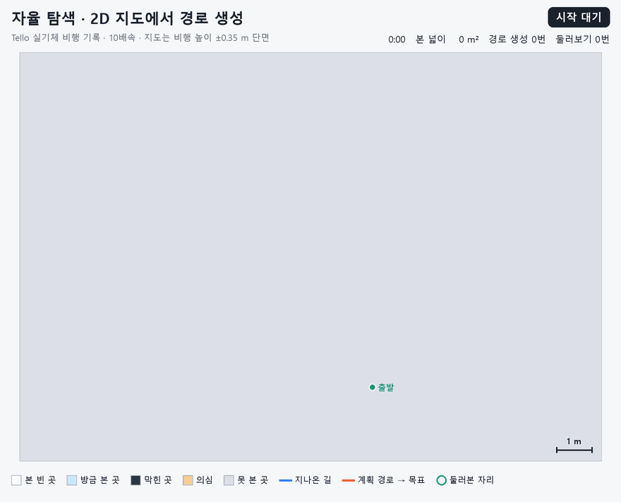
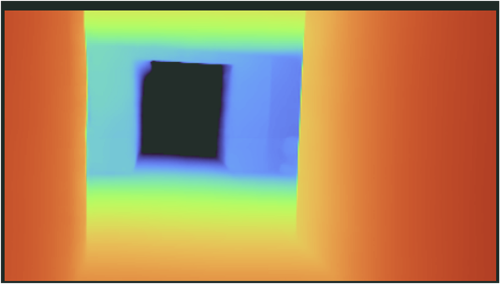
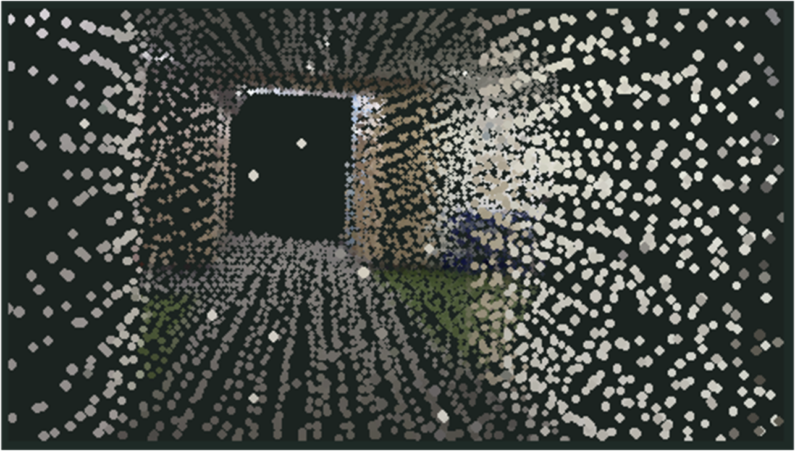
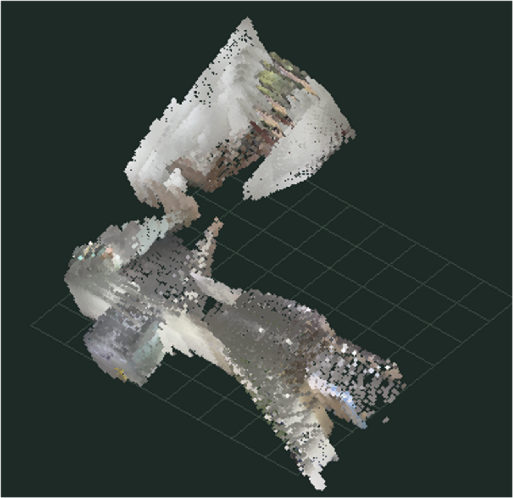
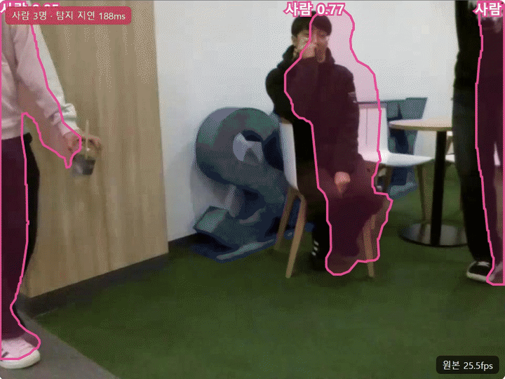

# Chill-Drone

<p align="center">
  
</p>

**팀 출발!드론팀**

Chill-Drone은 실내 재난 현장을 자율 탐색하는 드론 관제 프로젝트입니다. 드론이 아직 보지 못한 곳을 찾아 이동하고, 운용자는 한 화면에서 비행 경로, 요구조자 발견 알림, 실시간 3D 지도를 확인합니다.

## 드론 없이 시작하기

Windows에 Git, Python 3.12(64비트), Node.js LTS를 설치한 뒤 PowerShell에서 실행합니다. 첫 실행에는 의존성을 받을 인터넷 연결이 필요합니다.

```powershell
git clone https://lab.ssafy.com/s15-final/S15P31B205.git
Set-Location S15P31B205
.\scripts\start.cmd fake
```

브라우저에서 [체험 관제 화면](http://127.0.0.1:8030/#/live)이 열립니다. 시뮬레이터나 실기체를 사용하려면 [설치·실행 가이드](docs/RUN_GUIDE.md)에서 모드를 선택하세요.

## 대표 실행 장면

<p align="center">
  
</p>

### 실시간 3D 매핑

영상에서 깊이를 추정하고, 프레임의 점들을 카메라 자세에 맞춰 공통 좌표계에 쌓습니다.

| 1. 깊이 맵 | 2. 프레임 점군 | 3. 누적 3D 지도 |
| --- | --- | --- |
|  |  |  |

### 요구조자 탐지

드론 영상에서 사람을 찾으면 윤곽선과 신뢰도를 표시하고, 새 발견을 관제 화면에 알립니다.

<p align="center">
  
</p>

## 프로젝트 참여자

| 이름 | 담당 |
| --- | --- |
| 윤병현 | 장애물 회피, 목적지 지정 비행 |
| 김수호 | 3D 지도, 드론 위치 추정 |
| 박수경 | 영상·센서 데이터 처리, 지도 저장·조회 |
| 송승우 | 드론 통신 연동, 통합 관제 웹 개발 |
| 이수진 | 사람 탐지, 실내 공간 인식 |
| 허병우 | 자율 탐색 경로 계획, 비행 제어·시뮬레이션 |

## 문서

- [설치·실행 가이드](docs/RUN_GUIDE.md) · 체험, 시뮬레이터, 실기체 실행과 문제 진단
- [프로젝트 구조와 기능](docs/PROJECT_ARCHITECTURE.md) · 자율 비행, 탐지, 3D 매핑, 관제 사이의 연결
- [저장소·개발·운영 안내](docs/REPOSITORY_GUIDE.md) · 코드 위치, 테스트, CI와 배포
- [포팅 매뉴얼과 시연 시나리오](exec/README.md)
