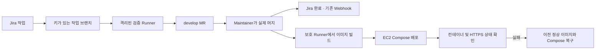

# EC2 및 GitLab·Jira CI/CD 운영

작업: [S15P31B205-15](https://ssafy.atlassian.net/browse/S15P31B205-15).
서버: `ubuntu@k15b205.p.ssafy.io`, Ubuntu 24.04 amd64, 메모리 약 16GiB.
개인 키, Runner 인증 토큰, Jira/GitLab Webhook 암호는 저장소에 보관하지 않습니다.

## 흐름

Jira 완료는 develop 머지를 의미합니다. 배포 성공을 의미하지 않으며 GitLab 파이프라인과
Environment의 결과를 별도로 확인합니다. Jira의 기존 Automation을 중복 등록하지 않습니다.

## 서버 구성과 포트

| 항목 | 구성 |
| --- | --- |
| SSH | 기존 22/tcp 유지, 제공된 키로 접속 |
| 외부 HTTPS | 443/tcp, Caddy가 Let's Encrypt TLS-ALPN-01로 발급·갱신 |
| 앱 연결 | 호스트 `127.0.0.1:18065` → 컨테이너 `18066` |
| UFW | enable 유지, 신규 허용은 443/tcp만 추가 |
| Docker | 공식 apt 저장소, Compose·Buildx 포함, 부팅 시 자동 실행 |
| Docker 포트 방화벽 | DOCKER-USER에서 외부 인터페이스의 신규 연결 차단 |
| 배포 상태 | `/srv/s15p31b205/releases`, `current`, `previous` |
| HTTPS 설정 | `/srv/s15p31b205-edge`, 인증서는 Docker named volume |
| Runner 인증 | root 전용 `/etc/gitlab-runner/config.toml` |

Caddy만 host network를 사용하며 관리 API·80 포트·HTTP/3는 비활성화합니다.
일반 앱·DB·관리 도구는 외부 IP에 직접 publish하지 않고 필요한 경우 HTTPS 뒤에 둡니다.
Docker TCP API 2375/2376, 기본 DB 포트, Jenkins 기본 포트는 열지 않습니다.

Docker 서비스의 ExecStartPost가 포트 차단 규칙을 다시 적용하므로 재시작·재부팅 뒤에도
적용됩니다. 기존 SSH/UFW를 초기화하지 않습니다. 새 서버는 저장소를 복사한 뒤
`sudo bash infra/server-setup.sh`로 구성합니다. 이미 실행 중인 앱이 있는 서버에서
설정 재적용은 변경 내용을 확인하고 진행합니다.

## Runner와 실행 조건

| Runner | 태그 | 권한·범위 |
| --- | --- | --- |
| k15b205 isolated verification | `ec2-verify` | Docker executor, privileged=false, Docker 소켓/호스트 디렉터리 미공유, 프로젝트 잠금 |
| k15b205 protected deployment | `ec2-deploy` | Shell executor, protected=true, 프로젝트 잠금, Docker 접근 가능 |

검증 Runner에는 토큰·개인 키·배포용 폴더를 mount하지 않습니다. 배포 Runner는 Docker를
제어하므로 호스트 관리자 수준 권한이 있습니다. 보호 브랜치의 신뢰된 코드에만 사용합니다.
두 Runner는 태그 없는 작업을 받지 않습니다. 배포 작업은 `resource_group`과 서버의
`flock`으로 중복 실행을 막습니다. 로컬 이미지가 같은 EC2에 있어 Registry 토큰과 EC2 SSH
개인 키를 CI 변수에 넣을 필요가 없습니다. 외부 Registry/복수 서버로 확장할 때 별도 구성합니다.

- 작업 브랜치/MR: 상태 서비스 테스트와 셸 문법 검사.
- 보호된 develop: 검증 → 커밋 SHA 이미지 빌드 → staging 자동 배포.
- 보호된 infra 브랜치: Maintainer가 웹에서 시작한 파이프라인에서만 빌드, 배포는 수동 실행.
- master 운영 배포: 별도 환경·승격 정책이 정해지면 구성합니다.
- 이미지·Compose가 정상이더라도 HTTPS 검사가 실패하면 배포는 실패하고 이전 버전을 복구합니다.
- 배포 실패 후 복구에 성공해도 작업의 종료 코드는 실패입니다.

`rollback-staging` 수동 작업은 이전 정상 release를 복원합니다. 서버에서 직접 복구할 때는
현재 checkout의 `sudo -u gitlab-runner bash infra/rollback.sh`를 사용합니다.
이전 release가 없으면 복구 작업은 실패하고, 첫 배포 실패 시 실패한 앱만 내립니다.
복구 이미지가 필요하므로 자동 image prune과 volume prune은 설정하지 않습니다.
배포는 기존 컨테이너를 교체하므로 짧은 중단이 있을 수 있습니다. DB 마이그레이션은
포함하지 않으며 나중에 스키마 호환성과 데이터 백업 정책을 별도로 설계해야 합니다.

## 상태 대시보드

`https://k15b205.p.ssafy.io/`는 PC·모바일에서 서비스 상태, 웹 응답 시간, 실행 중인
컨테이너 수, CPU·메모리·디스크 사용률, 서버 가동 시간 및 현재 배포 버전을 표시합니다.
브라우저와 호스트의 systemd timer는 3초 간격으로 갱신합니다. 호스트는 `docker ps --all`로
전체 컨테이너의 이름·이미지·실행 상태·상태 검사 결과를 수집하므로 새 컨테이너도 별도 등록 없이
표시됩니다. 실행/미실행 필터와 이름·이미지 검색, 동적으로 계산되는 전체/실행 개수를 제공합니다.
Docker·Runner는 별도의 서버 서비스 영역에 표시합니다. 공개 가능한 필드만
`/run/s15p31b205-status/runtime.json`에 씁니다. 상태 수집이 15초 넘게 지연되거나
서비스가 멈추면 화면은 정상으로 표시하지 않습니다. 웹 응답 시간은 브라우저에서
현재 상태 API 요청에 걸린 시간이며, CPU는 수집 시점의 짧은 표본입니다.

웹 컨테이너에는 Docker 소켓을 공유하지 않습니다. 상태 폴더만 읽기 전용으로 연결하며,
환경 변수·토큰·실행 명령·라벨·로그·내부 IP·호스트명은 API로 내보내지 않습니다.
Docker events에서 생성·시작·중지·종료·삭제·재시작·상태 검사 변경만 골라 최근 20건을
유지하고 화면에는 최대 8건을 표시합니다. 이벤트 시간 경계의 중복은 제거합니다. 수집 실패 시
이전 조회 시점을 유지해 재시도합니다. 이 최근 변경 기록은 재부팅 시 초기화되며,
Docker가 재조회에 제공하는 이벤트도 최근 256건으로 제한됩니다. 장기 이력 저장은 포함하지 않습니다.
`/healthz`의 기존 배포 검사 계약은 유지합니다. 새 서버의 전체 설치 스크립트는 상태
수집기도 설치합니다. 기존 서버에 수집기만 설치할 때는
`sudo bash infra/install-status-snapshot.sh`를 실행합니다. 부팅 때 tmpfiles가 폴더를
준비하고 timer가 수집을 재개합니다. 자동화용 API 주소를 상태 UI로 바꾸지 않습니다.

## 앱을 연결할 때 필요한 정보

현재 상태 서비스는 실제 BE·FE 빌드를 대신하지 않습니다. 앱 코드가 들어오면 다음을 연결합니다.

1. BE·FE 코드 위치, 빌드/테스트 명령, Dockerfile 및 실행 포트.
2. 준비 완료를 판단하는 `/healthz` 등 실제 상태 확인 경로.
3. DB·외부 API·JWT 등 필요한 환경 변수의 이름과 값. 값은 보호된 CI 변수 또는 서버의
   권한 제한 파일에 넣으며 채팅·MR·Jira·Git에 남기지 않습니다.
4. 운영 브랜치, 환경별 도메인, 배포 승인·DB 백업 정책.

Jenkins는 중복 설치하지 않습니다. GitLab이 파이프라인을 관리하고 EC2 Runner가 실행합니다.
배포 목적의 CI를 다시 도입하며 자동 리뷰 댓글이나 convention 차단은 포함하지 않습니다.

## 검증 기록

2026-10-22 Docker 29.9.2·Compose 5.6.1·GitLab Runner 19.5.0 설치, hello-world 실행,
Let's Encrypt 인증서 발급 및 외부 HTTPS 응답을 확인했습니다.
[첫 실제 파이프라인](https://lab.ssafy.com/s15-final/S15P31B205/-/pipelines/236454)에서
검증·빌드·배포 3개 작업이 통과했습니다. 후속 보완의 최종 파이프라인 결과는 MR에 기록합니다.
비정상 이미지를 실제로 배포해 unhealthy 판정, 배포 실패 종료, 이전 정상 이미지 복구,
HTTPS 정상 응답을 확인했습니다. 수동 rollback도 실제 실행했습니다.
외부에서 22·443 연결 성공 및 80·18065·2375·8080·9000 연결 차단을 확인했습니다.
Docker에 0.0.0.0:18067을 명시해 임시 컨테이너를 띄운 경우에도 localhost 응답은 성공하고
외부 연결은 차단되었으며 DOCKER-USER의 DROP 카운터 증가를 확인하고 임시 컨테이너를 정리했습니다.
Jira 이슈와 MR은 실제 develop 병합 전에는 이 작업의 완료로 표시하지 않습니다.
기존 협업 규칙 MR의 CI 비활성화 설정이 나중에 덮어쓰지 않도록 병합 시 충돌을 해결합니다.

## 공식 자료

- [Docker Ubuntu 설치](https://docs.docker.com/engine/install/ubuntu/)
- [Docker와 방화벽](https://docs.docker.com/engine/network/packet-filtering-firewalls/)
- [GitLab Runner 설치](https://docs.gitlab.com/runner/install/linux-repository/)
- [프로젝트 Runner와 보호 설정](https://docs.gitlab.com/ci/runners/runners_scope/)
- [Caddy 자동 HTTPS](https://caddyserver.com/docs/automatic-https)
