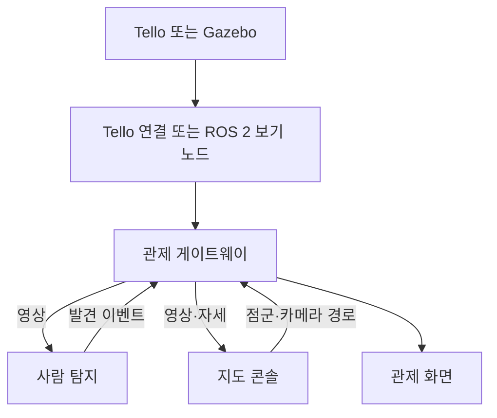

# 프로젝트 구조와 기능

Chill-Drone은 Tello EDU·RoboMaster TT 또는 Gazebo의 실내 비행을 관제 화면과 연결합니다. 운용자는 한 화면에서 자율 탐색 경로를 살피고, 영상의 사람 탐지 결과와 실시간으로 갱신되는 3D 점군을 확인합니다.

## 비행과 관제

- **실기체 수동 관제**에서는 Windows의 Tello 게이트웨이가 기체 명령, 상태, 영상 연결을 처리합니다. **자율 비행**에서는 ROS 2의 탐색·제어 노드가 기체나 Gazebo를 운용하고, 보기 노드가 비행 상태·위치·지도·경로를 관제 게이트웨이에 전달합니다. 관제에서 보낸 자율 비행 요청도 이 연결을 통해 전달됩니다.
- 관제 웹은 게이트웨이가 제공합니다. 실시간 감독의 **2D 지도**에는 자율 비행의 경로와 공간 정보가 표시됩니다. 자율 비행의 지도가 없고 3D 점군이 있으면 점군으로 만든 평면도를 표시할 수 있습니다.

[관제 화면](../apps/controller/README.md) · [Tello 게이트웨이](../modules/autonomy/tello_link/README.md) · [ROS 2 드라이버](../modules/autonomy/tello_driver/README.md) · [Gazebo 시뮬레이터](../simulation/tt-sim/README.md)

## 요구조자 탐지

사람 탐지 모듈은 게이트웨이 영상으로 YOLO26 인스턴스 세그멘테이션을 실행합니다. 탐지 결과는 사람 윤곽과 신뢰도, 발견 알림과 대표 사진으로 관제에 표시됩니다. 운용자는 발견을 확인하거나 오탐으로 표시할 수 있습니다. 지도에서 관제의 발견 지점은 탐지 시점의 드론 위치로 기록됩니다.

[사람 탐지 실행](../modules/perception/inference/README.md) · [발견 이벤트 계약](../contracts/perception/PERSON_DETECTION_EVENT_V1.md)

## 실시간 3D 지도와 저장 영상 복원

- **실시간 지도**는 드론 영상의 깊이와 카메라 자세를 바탕으로 3차원 점을 누적합니다. 지도 콘솔이 만든 점군과 카메라 경로를 지도 연결기가 게이트웨이로 보내면, 실시간 감독의 **3D 점군**에서 확인할 수 있습니다.
- **지도 복원**에서는 드론 영상·센서 세션 ZIP이나 일반 촬영 영상을 불러옵니다. 입력 유형에 따라 센서 자세를 사용하거나 영상에서 카메라 자세를 추정하고, 선택한 깊이 모델로 점군을 생성합니다.
- **지도 편집**에서는 저장된 점군을 확인·편집하고 Roomform으로 벽·바닥·천장 면을 복원할 수 있습니다.

[지도 콘솔](../apps/console/README.md) · [카메라 위치 추정](../modules/mapping/localization/README.md) · [지도 세션 포맷](../contracts/mapping/LIVE_SESSION_V1.md) · [모델 준비](../exec/EXTERNAL_SERVICES.md)

### 3D 매핑의 세 단계

1. [깊이 맵](architecture/mapping-depth.png) · 카메라 RGB 프레임에서 픽셀마다 카메라까지의 깊이를 추정합니다.
2. [프레임 점군](architecture/mapping-frame-cloud.png) · 카메라 내부 파라미터로 픽셀과 깊이를 카메라 좌표계의 3차원 점으로 변환하고 원본의 색을 연결합니다.
3. [누적 3D 지도](architecture/mapping-global-cloud.png) · 추적한 카메라 위치·방향으로 프레임 점군을 공통 좌표계에 정합합니다. 관제는 순차적으로 추가된 점과 카메라 경로를 표시합니다.

## 실행 위치와 저장 방식

관제, 탐지, 지도는 Windows 관제 PC에서 실행됩니다. 자율 비행과 시뮬레이션은 WSL에 함께 구성됩니다. EC2의 배포 대상은 상태 페이지입니다. 관제와 매핑 결과는 회차 폴더에 기록하며, 휴대폰 영상의 오프라인 SfM에는 선택형 COLMAP SQLite 파일을 사용합니다.

[실행 가이드](RUN_GUIDE.md) · [데이터와 기록 재생](../exec/DATABASE.md) · [EC2 운영](EC2_CICD.md)
