# tt-sim: RoboMaster TT 사양 실내 시뮬레이션 뼈대

교보재가 오기 전에, RoboMaster TT와 같은 센서 조건에서 자율비행·사람 탐지·지도 생성 코드를 개발하기 위한 Gazebo 시뮬레이션 뼈대입니다.

- **랜덤 실내 맵 생성기**: seed 하나로 방(사무실·거실·침실·회의실·창고)과 문, 가구, 지도에 없는 물건, 사람, 출발점, 목적지를 배치합니다. Gazebo 월드와 드론에게 줄 지도, 평가용 정답을 함께 씁니다.
- **TT 드론 모델**: 단안 카메라, 전방 단일점 ToF(최대 1.2 m, 시야 25°), 하방 거리 센서, IMU를 달고 속도 명령으로 움직입니다. 깊이 카메라는 없습니다.
- **자율비행 (1단계)**: 지도를 3D 복셀로 바꾸고, 3D A*로 경로를 계획하고, 경로를 따라 날아가 목적지에 착륙합니다.
- **사람 인식 (2단계)**: 드론 카메라 영상(175 ms 지연)에 YOLO를 돌려 사람을 잡고, 잡을 때마다 사진과 이벤트를 남깁니다.
- **지도에 없는 장애물 피하기 (3단계)**: 전방 ToF가 지도보다 가까운 것을 재거나 YOLO가 바닥에 선 물체(사람·의자 등)를 보면, 그 자리에 기둥을 세워 지도에 더하고 경로를 다시 짭니다.
- **지도 없이 탐색 (4단계)**: 카메라 영상 한 장에서 거리를 추정해 3D 지도를 만들며 돌아다니고, 장애물과 찾은 사람을 지도에 표시합니다.

## 진행 단계

| 단계 | 내용 | 상태 |
| --- | --- | --- |
| 1 | 3D 지도(복셀) + 경로 계획 + 경로 따라 자율비행 | ✅ Gazebo에서 6개 맵 모두 성공 |
| 2 | 카메라에 YOLO 연결해 사람 인식 | ✅ 3개 맵 94자리 모두 인식, 비행 중 실시간 탐지 확인 |
| 3 | 전방 ToF + YOLO로 지도에 없는 장애물 피하기 | ✅ 길을 막은 2단계 맵 6개를 ToF만·ToF+YOLO로 12번 날려 모두 착륙. 비행 중 갑자기 생긴 장애물 21개도 12번 모두 피해 착륙 |
| 4 | 정답 위치 떼기: Tello 상태값으로 위치 추정 + 지도 보정 | ✅ 정답 위치 없이 1·2단계 12번 모두 착륙. 목적지 오차 0.04–0.23 m, 위치 추정 오차 최대 0.13–0.32 m |
| 5 | 사람 찾기 탐색(목표 3단계): 못 본 곳을 골라 둘러보며 사람 찾기 | ✅ 정답 위치 없이 6개 맵 6번 모두 성공. 사람 18명 모두 찾음(위치 오차 0.00–0.52 m), 출발점 0.06–0.27 m 안에 착륙 |
| 6 | 지도 없이 지도 만들며 탐색(목표 4단계): 카메라 깊이 추정으로 장애물·사람 지도 + 카메라 지도로 위치 바로잡기 | 🔶 위치 바로잡기를 켜면 6개 맵 중 4번 성공(끄면 5번 중 2번). 위치 오차 최대 0.24–0.50 m(끄면 0.62–1.02 m), 사람은 좁은 출발 방인 seed 5 빼고 모두 3/3. 남은 실패는 위치 오차 0.16–0.20 m일 때 1–2 cm 닿음. 최종판으로 seed 1·2·3·7 다시 날리기가 남음 |
| 7 | 실기체와 같은 명령 경로: Tello 드라이버(rc·takeoff·land) + Gazebo Tello 흉내 | 🔶 1·2단계 12번 모두 드라이버로 이착륙, 충돌 없음, 9번 성공. 3번은 위치 추정 오차로 착륙 0.30–0.45 m 빗나감(원인 확인 중). 실기체는 아직 |

| 거실 | 회의실 |
| --- | --- |
| 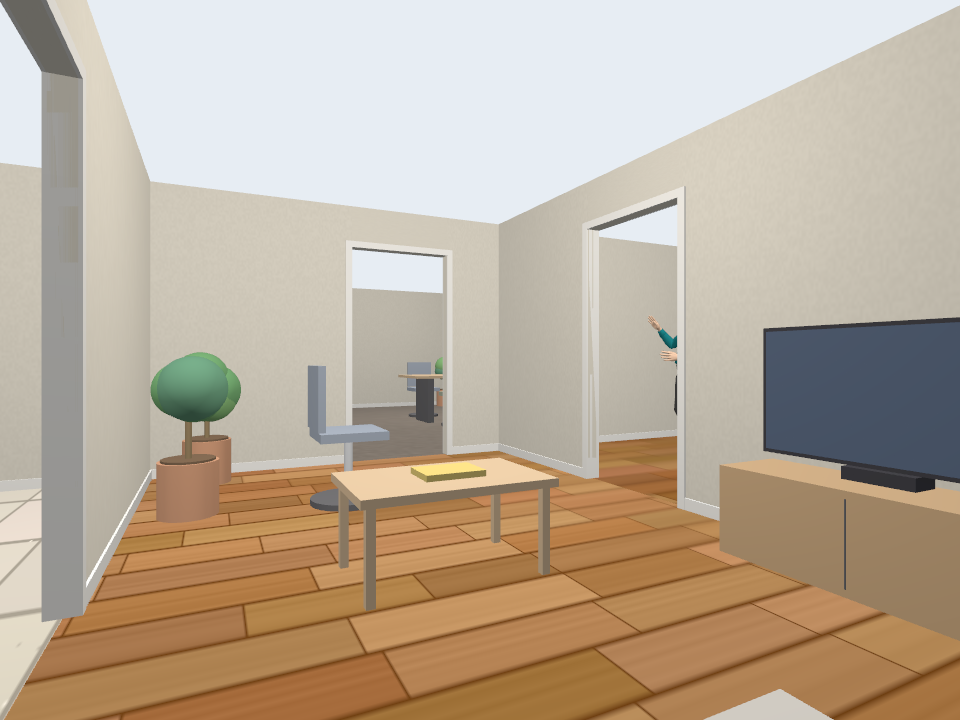 | 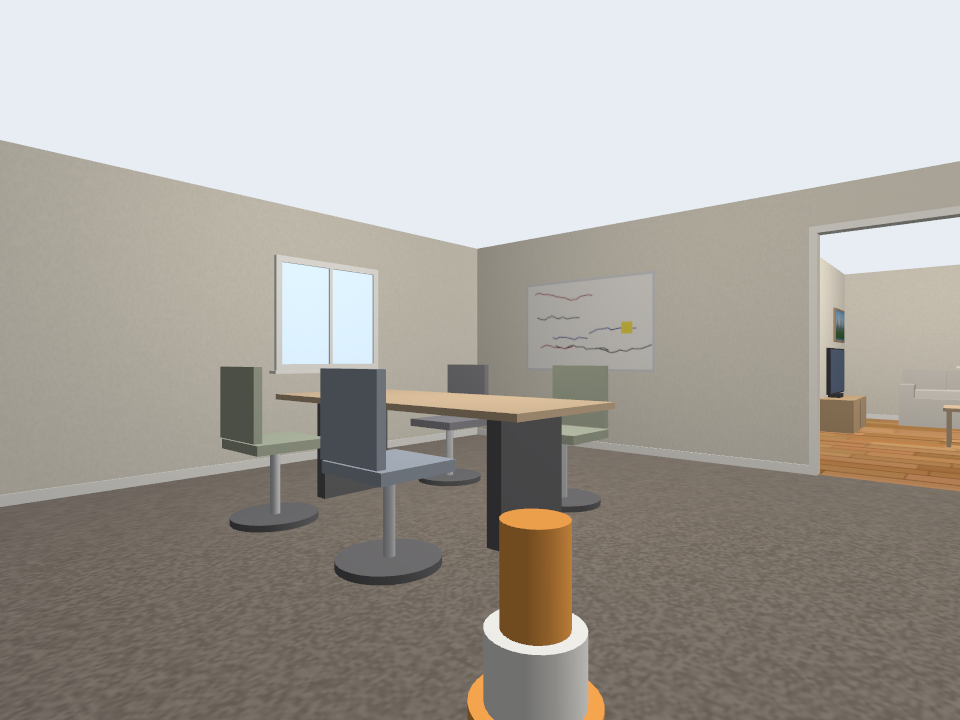 |
| **사무실** | **사람 탐지 대상** |
| 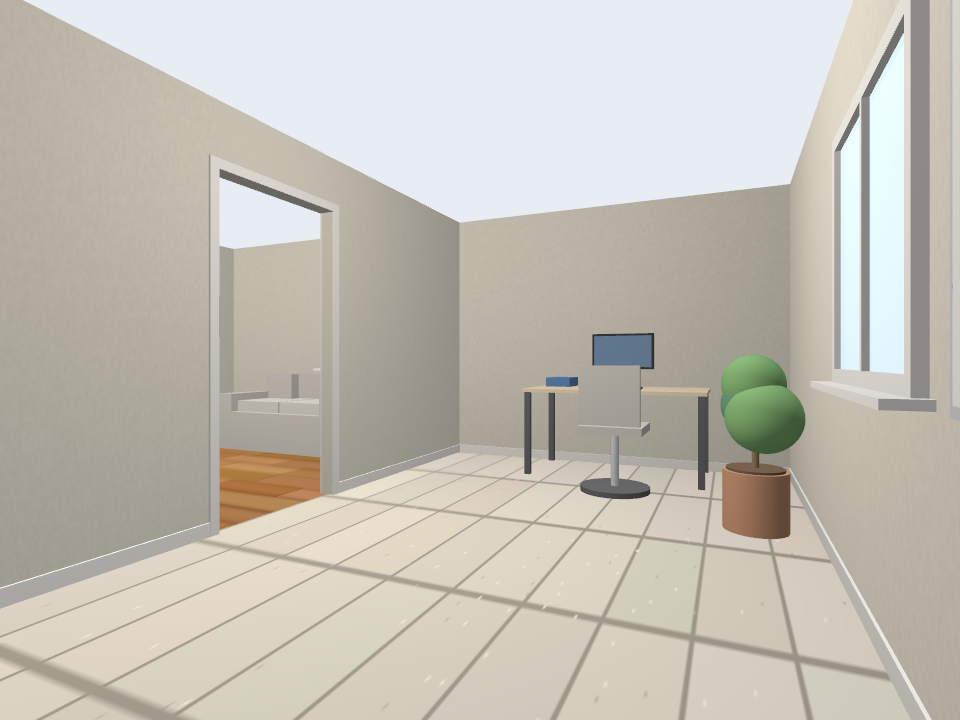 | 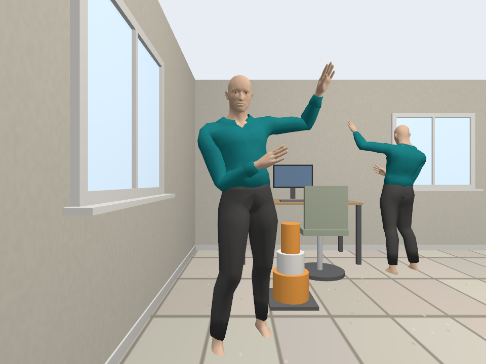 |

모두 시뮬레이션 드론 카메라(960×720)로 찍은 화면입니다(seed 7, 3단계).

## 현재 상태

| 항목 | 상태 |
| --- | --- |
| 10/30 실기체 반영 | 드라이버 '스스로 내려앉음'(grounded) 판정·rc 서서히 올리기·상승 중 하강 경고, 지도 없이 탐색(빈 지도), 지나간 사람을 길에서 빼기, 기둥은 옆으로·벽은 방향 바꾸기, 앞이 확실히 비면 빠르게(`fast`), 웹 화면에 YOLO·카메라 지도·사람 표시. 단위 시험 147·16·46 통과. 규칙은 [AVOIDANCE.md](AVOIDANCE.md), 실기체 절차·기록은 [rooms/lab/README.md](rooms/lab/README.md) |
| 맵 생성기·드론 모델 사양 | 단위 테스트 19개 통과. 맵 크기 8×6 m ~ 30×20 m에서 240개 생성 확인 |
| 자율비행 코드 | 단위 테스트 15개 통과 (복셀 지도, 경로 계획 15개 맵, 문 가운데 통과, 비행 높이 지키기, 가장 먼 곳 찾기, 경로 추종) |
| 사람 인식 | 단위 테스트 8개 통과 (카메라 투영, 탐지 상자, 중복 억제). YOLO11n + RTX 4070 GPU로 추론 평균 54 ms |
| 지도에 없는 장애물 | 단위 테스트 24개 통과 (ToF 기대 거리, YOLO 바닥 위치, 장애물 합치기, 작은 운동학 시뮬레이션으로 찾기→재계획→도착, `--blockers` 맵이 실제로 경로를 막는지) |
| Gazebo 실행 | Ubuntu 24.04(WSL2) + ROS 2 Jazzy + Gazebo Sim 8.15(Harmonic)에서 확인. 센서 토픽이 모두 나오고, 드론 카메라에 가구·사람이 보이고, GUI 3D 화면이 뜸 |
| 위치 추정 | 단위 테스트 24개 통과 (Tello 상태 문자열, 속도 적분, 높이, 지도 보정, 지도에 없는 물체·제자리 측정 거르기, 벽 앞 후보, 대부분 막혀도 따라가기, 위치 다시 잡기, 옆 미끄럼 없음, 가구 위에서 조금씩 줄어드는 하방 ToF(11/09)) |
| 사람 찾기 탐색 | 단위 테스트 5개 통과 (본 곳 지도, 다음 볼 자리, 생성 맵에서 사람 자리를 다 보는지, 찾은 사람 합치기) |
| 1단계 자율비행 | 6개 맵(seed 1–5, 7)을 날려 모두 착륙 성공. 정답 위치로 목적지 오차 0.00 m, 최소 간격 0.18–0.31 m. 정답 위치 없이(추정 위치로) 목적지 오차 0.04–0.23 m, 최소 간격 0.14–0.30 m |

## 폴더 구성

```
tt-sim/
├── generate_world.py        # 맵 생성 명령
├── worldgen/                # 맵 생성기 (표준 라이브러리만 사용. --blockers만 autonomy의 경로 계획을 빌려 씀)
│   ├── layout.py            #   방 나누기·방 종류, 가구·물건·사람·출발점·목적지 배치, 단계 규칙
│   ├── furnish.py           #   가구·잡동사니·벽 장식 모양 (기본 도형 조립)
│   ├── grid.py              #   연결성 검사용 점유 격자
│   ├── sdf.py               #   Gazebo 월드(SDF) 작성
│   ├── images.py            #   마루·타일·카펫·콘크리트·벽·그림 텍스처, 미리보기
│   └── export.py            #   파일 쓰기
├── autonomy/                # 자율비행 핵심 (ROS와 무관, 실기체에도 그대로 쓴다)
│   ├── voxel_map.py         #   3D 복셀 지도 만들기·부풀리기·저장·점 구름 내보내기
│   ├── planner.py           #   3D A* 경로 계획 + 경로 단순화
│   ├── follower.py          #   경로 점을 따라가는 속도 명령 계산
│   ├── obstacles.py         #   지도에 없는 장애물 찾기 (ToF 기대 거리 비교, YOLO 바닥 접점 위치, 모아 두기)
│   ├── state_estimator.py   #   Tello 상태값 + 지도로 위치 추정 (파티클 필터)
│   ├── explore.py           #   3단계 사람 찾기 탐색 (본 곳 지도, 다음 볼 자리, 찾은 사람, 지나간 사람 풀기)
│   ├── shape.py             #   깊이 장면에서 앞이 기둥인지 벽인지 (폭 재기, 비켜 갈 쪽)
│   ├── speed.py             #   앞이 확실히 비면 speed → fast로 올리기 (카메라·ToF·곧은 경로)
│   ├── near.py              #   가까운 장애물 앞 규칙 (늦게 잡힌 ToF = 유리, 들어온 길로 물러나기·자취 되짚기, 닿음 판단, 틈 30×20 cm)
│   ├── camera_map.py        #   4단계 카메라 깊이로 3D 지도 만들기, 경계(frontier) 고르기, 막힌 경계 다가가기
│   ├── contact.py           #   모든 비행 단계 닿음 감지(수평 가속·기울기·돌라는데 안 돎·가라는데 안 감)와 떼어 낼 방향 (11/13–14)
│   ├── doorway.py           #   경로 위의 문(좁은 틈) 찾기: 가운데·지나갈 방향·폭 (11/05)
│   ├── goto.py              #   운용자가 웹 지도에서 찍은 자리: 명령 읽기, 막힌·못 본 곳이면 갈 수 있는 빈 자리로 옮기기 (11/11)
│   ├── scan_match.py        #   4단계 깊이 영상을 예전 지도에 대어 위치 바로잡기
│   └── flight_record.py     #   4단계 비행 기록 (깊이 영상·추정 위치·ToF)
├── perception/detect.py     # YOLO 감싸기, 탐지 상자 그리기, 중복 억제, 카메라 투영 (ROS와 무관)
├── perception/depth.py      # 카메라 한 장으로 깊이 추정 (Depth Anything V2, 화각 보정, 바닥으로 배율 맞추기)
├── nodes/mission_node.py    # 자율비행 ROS 2 노드 (이륙 → 계획 → 추종 ⇄ 재계획 → 착륙)
├── nodes/detector_node.py   # YOLO 탐지 ROS 2 노드 (탐지 JSON, 상자 그린 영상, 사람 사진 저장)
├── nodes/depth_node.py      # 깊이 추정 ROS 2 노드: 카메라 영상 → /tt/depth (4단계 지도용)
├── nodes/pose_node.py       # 위치 추정 ROS 2 노드: Tello 상태값 + 지도 보정 → /tt/pose_est (실기체 공통)
├── nodes/gz_tello.py        # (시뮬레이션 전용) Gazebo 드론을 UDP로 말하는 Tello처럼: 드라이버의 SDK 명령(rc·takeoff·land)으로 움직이고 상태를 보낸다
├── nodes/sim_tello_state.py # (시뮬레이션 전용, --direct 비교용) Tello 상태 문자열 흉내 → /tt/state
├── simdrone/tello_emu.py    # (시뮬레이션 전용) Tello 흉내 값: 상태 문자열(잡음·배율 오차·yaw 누적), 이륙·착륙 단계, rc → 속도(1차 지연)
├── tools/plan_route.py      # Gazebo 없이 지도·경로 확인 (plan.png, map3d.png, voxels.ply)
├── tools/eval_flight.py     # 비행 기록을 정답과 비교해 성공·실패 판정 (flight.png)
├── tools/eval_detection.py  # 사람 인식률을 거리·방향별로 측정 (detection_eval.csv/png)
├── tools/eval_ground.py     # YOLO 상자로 추정한 사람 위치 오차 측정
├── tools/spawn_obstacles.py # 비행 중 드론 앞에 장애물을 갑자기 만드는 시험 노드 (spawned.json)
├── tools/log_truth.py       # (평가 전용) 정답 위치 기록 (truth_log.csv)
├── tools/replay_pose.py     # Gazebo 없이 기록된 궤적으로 위치 추정기를 다시 돌려 값 비교 (비행 하나 1–2초)
├── tools/eval_depth.py      # 카메라 깊이 추정 정확도 측정 (평가 전용 정답 깊이 카메라와 비교, --doors, --save-raw)
├── tools/eval_map.py        # 4단계 지도를 정답과 비교, 장애물·사람을 표시한 map.png
├── tools/replay_map.py      # 4단계 비행 기록을 Gazebo 없이 다시 돌려 지도·위치 맞추기 평가 (비행 하나 20–60초)
├── tools/make_room_map.py   # 실기체 시험 공간 지도(known_map.json) 만들기: 잰 크기·출발점·목적지·장애물 상자, 목적지 검사
├── nodes/wander_node.py     # 지도 없이 둘러보기: 전방 ToF 하나로 울타리 안을 돌아다닌다 (Gazebo만, 실기체는 11/03에 뺌)
├── tools/eval_dwell.py      # 비행 기록에서 제자리에 머문 시간(정지·제자리 회전)을 단계별로 잰다
├── tools/flight_viewer.py   # 실기체 비행 기록 한 폴더를 한 페이지(viewer.html)로: 영상·깊이·지도·시계열·사건·로그를 같은 시각에
├── tools/room_world.py      # 시험 공간 지도 → Gazebo 월드 (+ 지도에 없는 물건). 실기체 비행 전에 같은 경로로 미리 날려 본다
├── rooms/lab/               # 실습실 3D 모델(room_v2.json)·비행 지도·실기체 자율비행 안내(README.md: 절차·비행 1~4·시험 기록)
├── models/tt_drone/         # TT 사양 드론 모델
├── launch/mission.launch.py # 시뮬레이션 + 자율비행 한 번에 실행 (web:=true면 자율비행 웹 화면도)
├── launch/real.launch.py    # 실기체: 탐색 하나 — 드라이버 + 위치 추정 + 깊이 + YOLO + 비행 노드 + 웹 화면 (Gazebo 없음)
├── launch/sim.launch.py     # Gazebo + ROS 2 토픽 브리지 + 영상 지연 노드
├── config/bridge.yaml       # Gazebo ↔ ROS 2 토픽 연결
├── scripts/latency_relay.py # 카메라 영상 175 ms 지연
├── scripts/setup_jazzy.sh   # Ubuntu 24.04에 ROS 2 Jazzy + Gazebo Harmonic 설치
├── scripts/setup_yolo.sh    # YOLO 가상환경(~/venvs/tt) 만들기
├── scripts/watch_mission.sh # Gazebo 화면으로 자율비행 보기 (--detect면 YOLO 화면도)
├── scripts/run_mission.sh   # 화면 없이 한 번 날리고 결과만 보기 (--detect, --no-avoid, --spawn N, --direct)
├── scripts/eval_detection.sh# 사람 인식 평가 한 번에 실행
├── scripts/eval_depth.sh    # 깊이 추정 평가 한 번에 실행
├── docs/                    # 실행 확인 화면
└── tests/                   # 단위 테스트
```

## 드론 모델: TT 사양 대응표

| 항목 | 실제 TT | 시뮬레이션 | 비고 |
| --- | --- | --- | --- |
| 무게·크기 | 87 g, 98×92.5×41 mm | 같음 | DJI 사양 |
| 충돌 외곽 | 프로펠러 가드 포함 | 지름 0.18 m, 높이 0.05 m 원기둥 | 가정, 실측으로 교체 |
| 카메라 | 단안 5 MP, 스트림 960×720, 30 fps, FOV 82.6°(스펙; **스트림의 실측 수평 화각은 54.7°**, 11/03) | 같은 해상도·주기, 수평 화각 82.6°(시뮬 모델 그대로, 실기체 launch는 0.955 rad) | 스트림 크롭 여부 미확인 → 캘리브레이션으로 교체 |
| 영상 지연 | Wi-Fi 경유 평균 약 175 ms | `latency_relay.py`가 175 ms 늦춤 | AirSwarm(arXiv 2503.06890) 측정치 |
| 전방 거리 | 단일점 ToF, 최대 1.2 m | 가운데·위·아래(±12.5°) 세 줄 × 광선 7개(±12.5°) 라이다, 0.1–1.2 m. 21개 중 최솟값 하나만 쓴다 | 시야 25°(VL53L0X 계열 기준)·10 Hz는 가정 |
| 하방 거리 | 바닥 높이 측정 | 하방 라이다, 0.1–6 m | 최대 거리·주기는 가정 |
| 비행 | 기체가 자세 제어, SDK로 속도·이동 명령 | 속도 명령을 그대로 적용하는 운동학 모델 | 그래서 월드 중력이 0 |

## 빠른 시작 (Ubuntu 24.04)

Windows라면 WSL2에 Ubuntu 24.04를 깔아 쓰면 됩니다. Windows 11의 WSLg 덕분에 Gazebo 창이 Windows 화면에 그대로 뜹니다.

```bash
wsl --install -d Ubuntu-24.04
```

1. 설치 (ROS 2 Jazzy + Gazebo Harmonic, 10–20분)

   ```bash
   sudo bash scripts/setup_jazzy.sh
   ```

   ROS 공식 설치 순서를 그대로 옮긴 스크립트입니다. 끝나면 새 터미널을 열거나 `source /opt/ros/jazzy/setup.bash`를 실행하세요.

2. 맵 생성

   ```bash
   python3 generate_world.py --seed 7 --stage 3
   ```

   `worlds/s7_stage3/` 아래에 파일이 생깁니다. 텍스처 경로가 절대 경로로 들어가므로 **Gazebo를 돌릴 PC에서 생성**하세요.

3. Gazebo만으로 띄우기

   ```bash
   export GZ_SIM_RESOURCE_PATH=$PWD/models
   gz sim -r worlds/s7_stage3/world.sdf
   ```

   다른 터미널에서 위로 0.3 m/s 올리기, 그리고 멈추기:

   ```bash
   gz topic -t /tt/cmd_vel -m gz.msgs.Twist -p 'linear: {z: 0.3}'
   gz topic -t /tt/cmd_vel -m gz.msgs.Twist -p 'linear: {z: 0}'
   ```

4. ROS 2와 함께 띄우기

   ```bash
   ros2 launch launch/sim.launch.py world:=$PWD/worlds/s7_stage3/world.sdf
   ```

**Gazebo 창이 닫히지 않을 때**: WSL에서는 Gazebo GUI가 일반 종료 신호를 무시하는 경우가 있습니다. 아래 명령으로 강제 종료하세요.

```bash
pkill -9 -f "gz sim"
```

## 자율비행 (1단계)

| 3D 지도와 계획 경로 | 실제 비행 궤적 (seed 2) |
| --- | --- |
| 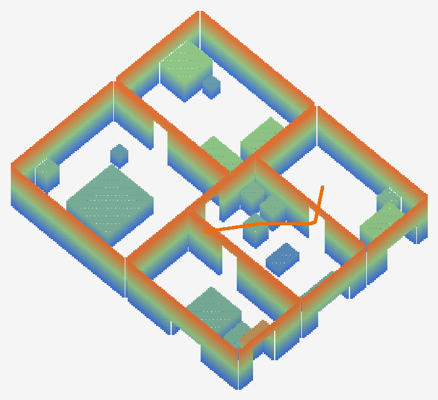 | 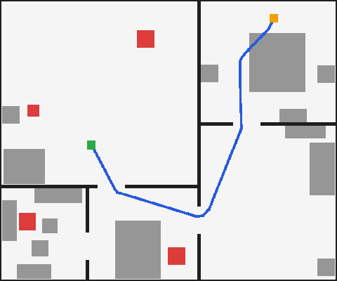 |

**지도: 3D 복셀.** 공간을 10 cm 정육면체로 나눠 칸마다 '막힘/비어 있음'만 적은 가장 단순한 3D 지도입니다. `known_map.json`의 벽·문 위 벽·가구 상자를 칸으로 바꾸고, 드론 크기(반지름 0.25 m)만큼 부풀린 지도로 경로를 찾습니다. 12×10 m 맵이 120×100×25칸이고, 만드는 데 0.1초도 안 걸립니다. 나중에 카메라로 만드는 지도도 같은 형식에 채우면 아래 코드는 그대로 씁니다.

**경로: 3D A\*.** 높이 0.4–1.8 m 사이에서 26방향으로 이웃 칸을 탐색하고, 직선으로 이어도 되는 점은 건너뛰어 경유점을 줄입니다. 낮은 가구는 위로 넘어가고, 키 큰 가구와 벽은 돌아갑니다. 계획은 0.1–0.5초 걸립니다.

**문·통로는 가운데로.** 부풀린 지도의 경계에 딱 붙은 경로는 위치가 0.15 m만 틀어져도 벽에 닿습니다(드론 외곽과 벽 사이 0.16 m). 그래서 경계에서 0.2 m 안의 칸은 지나는 비용을 최대 3배로 올려, 문과 좁은 통로는 가운데로, 넓은 곳은 벽에서 떨어져 지나게 합니다. 경로를 단순하게 만들 때도 원래 경로보다 경계에 더 붙는 지름길은 쓰지 않습니다. 폭 1 m 문을 비스듬히 지날 때 예전 경로는 문 중심에서 0.16 m 벗어나 문틀 쪽을 지났고, 지금은 0.05 m 안으로 지납니다(`tests/test_autonomy.py`). 오르내리는 칸은 비용을 2배로 쳐서, 넓은 곳을 찾아 괜히 높이를 바꾸지 않습니다.

**비행: 경유점 추종.** TT 센서가 앞만 보므로 먼저 진행 방향으로 기수를 돌린 뒤 앞으로 갑니다. 목적지 근처에서 감속합니다. 가는 중에 지도에 없는 장애물을 만나면 다시 계획합니다(3단계 절).

```
[이륙 1 m] → [3D 경로 계획] → [경유점 따라 비행] → [착륙] → DONE
                                  ⇅ 지도에 없는 장애물 → 지도에 더하고 다시 계획
```

실행:

```bash
python3 generate_world.py --seed 7 --stage 1
python3 tools/plan_route.py worlds/s7_stage1          # Gazebo 없이 지도·경로 확인
ros2 launch launch/mission.launch.py world_dir:=$PWD/worlds/s7_stage1
python3 tools/eval_flight.py worlds/s7_stage1         # 비행이 끝난 뒤 결과 확인
```

화면 없이 돌리려면 `headless:=true`를 붙입니다. 비행 기록은 `worlds/s7_stage1/flight_log.csv`에 남습니다.

**Gazebo 화면으로 보기.** 아래 명령 하나로 Gazebo 창을 띄우고, 카메라가 드론 뒤 위쪽에서 따라가게 한 뒤 비행을 시작합니다. 끝나면 결과를 출력하고 창은 열어 둡니다. 터미널에서 Ctrl+C를 누르면 Gazebo 창까지 함께 닫힙니다.

```bash
bash scripts/watch_mission.sh worlds/s7_stage1
```

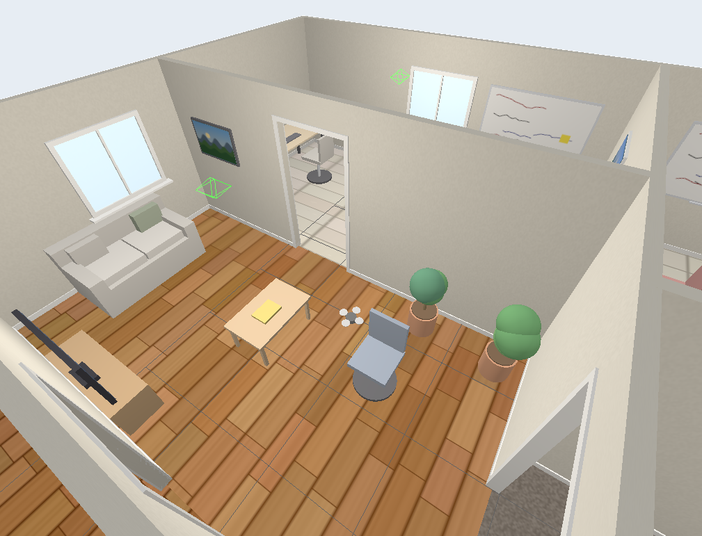

> 위치는 이제 시뮬레이션 정답이 아니라 **Tello 상태값으로 추정한 위치**(`/tt/pose_est`)를 씁니다. 아래 '정답 위치 없이 날기' 절 참고. 비교용으로 정답 위치로 날리려면 `--gt-pose`(run_mission.sh·watch_mission.sh) 또는 `pose:=gt`(launch)를 줍니다.

## 사람 인식 (2단계)

| 비행 중 실시간 탐지 | 거리·방향별 평가 (seed 12) |
| --- | --- |
| 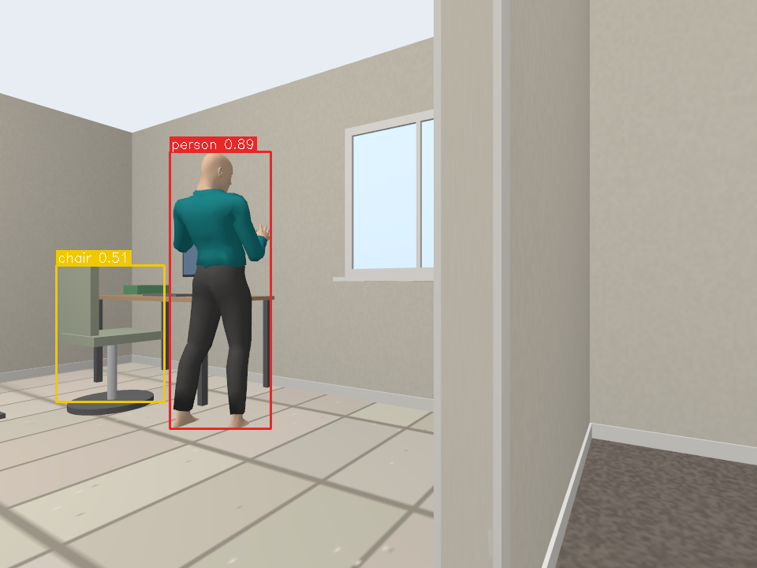 | 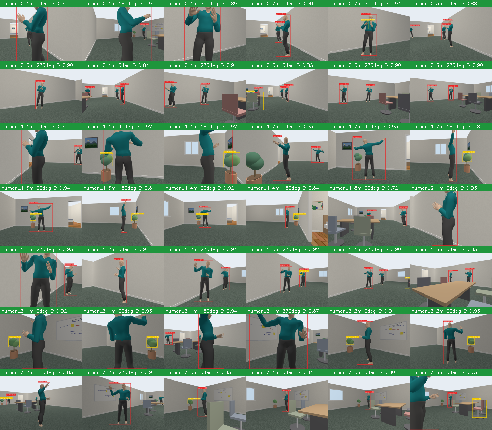 |

**구성.** 탐지 노드가 드론 카메라 영상(`/tt/camera/image_delayed`, 실제 TT처럼 175 ms 늦게 도착)에 YOLO11n(COCO 사전학습)을 초당 5번 돌립니다. 처리하는 동안 들어온 프레임은 쌓지 않고 가장 최근 것만 남깁니다(로그의 '버린 프레임'). 결과는 세 가지로 나옵니다.

| 출력 | 내용 |
| --- | --- |
| `/tt/detections` | 프레임마다 JSON: 촬영 시각, 프레임 지연(ms), 상자 목록(클래스·신뢰도·좌표) |
| `/tt/detections/image` | 상자를 그린 영상 (`ros2 run rqt_image_view rqt_image_view /tt/detections/image`) |
| `out_dir` | 사람을 잡으면 사진 PNG + `events.jsonl` 한 줄 (같은 대상 연속 탐지는 2초에 한 번만) |

**설치 (한 번만, 약 6 GB).** torch·ultralytics를 ROS 2와 함께 쓸 가상환경을 만듭니다. GPU가 있으면 자동으로 씁니다.

```bash
sudo apt install -y python3-venv
bash scripts/setup_yolo.sh
```

**비행하며 보기.** Gazebo 창과 함께 YOLO 상자 창이 뜨고, 사람을 잡을 때마다 터미널에 출력됩니다. 사진은 `worlds/s7_stage3/detections/`에 저장됩니다.

```bash
python3 generate_world.py --seed 7 --stage 3
bash scripts/watch_mission.sh worlds/s7_stage3 --detect
```

목적지가 없는 지도(3·4단계)에서는 갈 수 있는 가장 먼 곳으로 날아갑니다. 사람을 일부러 찾아가는 탐색은 4단계 작업입니다.

**인식 성능 측정.** 사람마다 거리 1–8 m, 사람 기준 4방향에 드론을 순간이동시켜 한 장씩 찍고, 그 사람이 잡혔는지 봅니다. 벽·가구에 가려 안 보이는 자리는 뺍니다.

```bash
bash scripts/eval_detection.sh worlds/s7_stage3 --distances 1,2,3,4,5,6,8
```

| 거리 | 자리 | 인식 | 평균 신뢰도 |
| --- | --- | --- | --- |
| 1 m | 33 | 33 (100%) | 0.89 |
| 2 m | 25 | 25 (100%) | 0.91 |
| 3 m | 14 | 14 (100%) | 0.89 |
| 4 m | 12 | 12 (100%) | 0.87 |
| 5 m | 5 | 5 (100%) | 0.82 |
| 6 m | 4 | 4 (100%) | 0.75 |
| 8 m | 1 | 1 (100%) | 0.72 |

seed 7(12×10 m), 11·12(20×15 m) 3단계 맵, 사람 11명 합계. 4방향 모두 100%였고, 멀어질수록 신뢰도가 낮아집니다.

> **이 숫자를 실제 성능으로 보면 안 됩니다.** 시뮬레이션 사람은 한 가지 모델(같은 사람·옷·자세)이고, 조명이 고르고, 흔들림·압축 노이즈가 없습니다. 이 평가는 '탐지 → 이벤트 → 사진' 흐름과 거리에 따른 경향을 확인하는 용도이고, 실제 성능은 실제 영상으로 따로 재야 합니다.

## 지도에 없는 장애물 피하기 (3단계)

| 회피 켬: 받은 지도로 짠 경로(회색 점선)가 막히자 돌아감 (seed 7, ToF+YOLO) | 회피 끔: 막혀서 중단 (seed 7) |
| --- | --- |
| 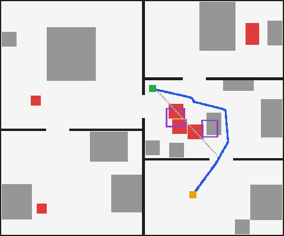 | 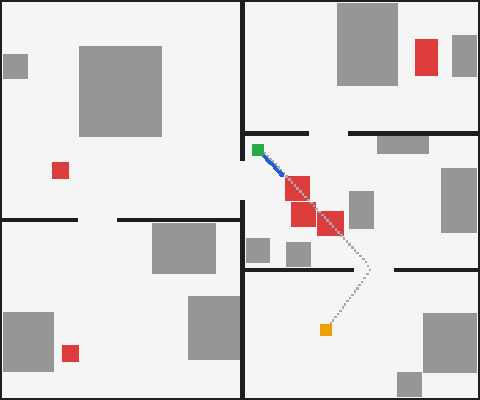 |
| **좁은 창고 문 앞을 재계획 4번으로 통과 (seed 5, ToF만)** | |
| 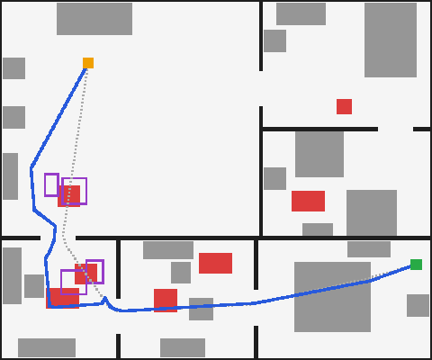 | 빨강 = 지도에 없던 물건, 회색 = 지도에 있는 가구, 보라 테두리 = 비행 중 찾은 장애물, 파랑 = 실제 궤적, 초록·주황 = 출발점·목적지 |

**찾기: 전방 ToF.** 실제 TT의 ToF는 원뿔(시야 25°로 가정) 안에서 가장 가까운 거리 **하나만** 줍니다. 같은 원뿔을 받은 지도에 쏘아 '지도대로라면 몇 m에서 막혀야 하는지'를 구해 두고, 측정값이 그보다 0.2 m 넘게 가까운 것이 두 번 연속 나오면 지도에 없는 물체로 봅니다. 방향은 모르므로 정면에 기둥을 세우고, 폭은 그 거리의 원뿔 폭, 깊이는 0.6 m로 가정합니다. 측정한 순간의 위치·방향으로 비교합니다(돌고 있을 때 최신 위치로 비교하면 옆 벽을 장애물로 착각합니다).

**찾기: YOLO.** 사람·의자처럼 바닥에 서는 COCO 물체(`autonomy/obstacles.py`의 `AVOID_CLASSES`)는 상자 아래 변이 바닥에 닿는 점을 카메라 높이로 되짚어 위치를 구합니다(약 1.5–4 m 앞). 영상이 늦게 오므로 촬영 시각의 드론 위치로 계산합니다. 원래 지도에 있는 물체이거나 벽 너머로 나오면 버리고, 비슷한 자리에서 두 번 보이면 기둥을 세웁니다. 상자 더미·라바콘·카트는 COCO에 없어 ToF로만 찾습니다.

두 센서 모두 높이를 제대로 모르므로 찾은 장애물은 **바닥부터 천장까지 막힌 기둥**으로 두고, 크기를 어림한 것이라 0.3 m(원래 지도는 0.25 m) 부풀립니다. 여러 번 본 상자를 하나로 감싸 합치지 않고 따로 둡니다. 다른 방향에서 본 상자를 감싸면 실제보다 훨씬 커져 문 앞·창고 같은 좁은 길을 막기 때문입니다.

**피하기.** 새 기둥이 남은 경로를 막으면 멈추고 지금 자리에서 3D A*로 다시 계획합니다. 회피할 때는 ToF가 보는 방향(±12.5°)으로만 움직이도록 기수를 12° 안으로 맞춘 뒤 나아갑니다.

```
FOLLOW ──새 장애물이 남은 경로를 막음──────────────▶ REPLAN ──▶ FOLLOW
   └── ToF < 0.35 m, 또는 움직이라는데 2.5초 제자리 ──▶ BACKOFF(0.2 m 뒤로) ──▶ REPLAN
   └── 좁은 곳(유리 사이)에서 멈추거나 닿음 ──▶ EXIT(들어온 자취를 거꾸로 0.6–3 m, 기수 고정) ──▶ REPLAN
REPLAN에서 길이 없으면: 찾은 장애물 여유를 0.2 m로 줄여 한 번 더 → 카메라로만 본 장애물을 빼고 한 번 더 → ABORT
```

**시험 맵.** `--blockers N`은 드론이 받은 지도로 짤 경로 위에, 경로가 물건 가운데쪽을 지나도록 지도에 없는 **상자 더미(1.2–1.6 m)와 사람**을 번갈아 놓습니다. 출발점·목적지 1.2 m, 문 앞은 비우고, 놓은 뒤에도 실제로 목적지까지 갈 수 있는지 확인합니다. 원래 있던 지도에 없는 물건(라바콘·카트·의자 등)도 그대로 있습니다.

```bash
python3 generate_world.py --seed 7 --stage 2 --blockers 2
bash scripts/watch_mission.sh worlds/s7_stage2 --detect    # Gazebo 화면 + YOLO 화면으로 보기
bash scripts/run_mission.sh worlds/s7_stage2 --detect      # 화면 없이 결과만
bash scripts/run_mission.sh worlds/s7_stage2 --no-avoid    # 비교: 회피 없이 (멈추고 중단)
```

**결과 (Gazebo, 화면 없이).** `--blockers 2`로 만든 2단계 맵 6개(12×10 m)를 같은 맵에서 세 가지로 날렸습니다. 칸마다 결과 · 재계획 횟수 · 지도에 없던 물건과의 최소 간격(드론 외곽 기준)입니다.

| seed | 원래 경로를 막은 물건 | ToF만 | ToF + YOLO | 회피 끔 |
| --- | --- | --- | --- | --- |
| 7 | 2 (상자 더미, 사람) | 성공 · 2 · 0.23 m | 성공 · 2 · 0.23 m | 중단 (멈추기 전 사람에 닿음) |
| 1 | 1 | 성공 · 2 · 0.62 m | 성공 · 2 · 0.62 m | 중단 |
| 2 | 2 | 성공 · 1 · 0.22 m | 성공 · 2 · 0.49 m, YOLO가 사람을 1.7 m 앞에서 | 중단 |
| 3 | 2 | 성공 · 2 · 0.09 m | 성공 · 6 · 0.14 m, YOLO가 사람을 2.2 m 앞에서 | 중단 |
| 4 | 2 | 성공 · 6 · 0.05 m | 성공 · 6 · 0.41 m | 중단 |
| 5 | 2 | 성공 · 4 · 0.32 m | 성공 · 3 · 0.31 m, YOLO가 사람을 2.6 m 앞에서 | 중단 |

- **회피를 켜면 12번 모두 목적지에 착륙**했습니다(목적지 오차 0.12–0.24 m). 벽·가구까지 포함한 최소 간격은 0.05–0.17 m, 비상 정지는 0번이었습니다. 회피를 끄면 6번 모두 막혀 중단했고, seed 7은 멈추기 전에 옆에서 다가온 사람에 닿았습니다.
- 위 표는 경로 계획기를 바꾸기 전(문·통로 가운데로, 비행 높이 지키기) 결과입니다. 바꾼 뒤 정답 위치·ToF만으로 다시 날린 결과는 '정답 위치 없이 날기' 절 표의 마지막 열입니다(6/6, 최소 간격 0.02–0.35 m).
- **가장 아슬아슬한 곳은 seed 4(ToF만) 0.05 m**입니다. ToF로 세운 기둥 크기가 어림이라 옆을 스치듯 지났습니다. 같은 맵에서 YOLO를 켜면 0.41 m였습니다.
- **YOLO는 6개 중 3개 맵에서 사람을 ToF보다 먼저(1.7–2.6 m 앞)** 잡았고, 추정 위치는 실제와 0.06–0.19 m 차이였습니다. 나머지 3개 맵에서는 사람이 YOLO 거리에 들어오기 전에 ToF가 먼저 잡았거나 다른 물건에 가려 있었습니다.
- **YOLO 오탐도 한 번 있었습니다.** seed 3에서 지도에 있는 침대를 'bed'(신뢰도 0.48)로 잡았는데 위치가 어긋나 지도 밖 장애물로 들어갔고, 그 기둥이 길을 막았습니다. '카메라로만 본 장애물을 빼고 다시 계획'으로 빠져나왔습니다.
- 숨은 물건 없는 1단계 맵 6개도 이 코드로 다시 날려 모두 성공했습니다(위 '현재 상태').
- 매번 같은 결과가 나오는지(반복성)는 아직 재지 않았습니다. 맵마다 한 번씩 날린 결과입니다.

**YOLO 위치 정확도.** 드론을 사람 앞에 순간이동시켜 잰 정지 상태 오차는 2–3 m에서 앞뒤 +0.03–0.09 m, 옆 0.15 m 이하였습니다(`tools/eval_ground.py`, 표본 5개). 1.5 m보다 가까우면 발이 화면 아래로 잘려 이 방법을 쓸 수 없습니다.

**가까운 사람.** 사람이 ToF 원뿔 옆으로 다가오면 ToF는 못 보고, 카메라에는 보이지만 발이 잘립니다. 3단계 시험에서 이렇게 사람에게 0.24 m까지 붙어 지나간 일이 있어, 발이 잘린 사람(신뢰도 0.7 이상)은 머리 높이(키 1.7 m로 가정)나 상자 폭(어깨너비 0.45 m로 가정) 중 더 가까운 쪽으로 거리를 어림해 **한 번만 보여도 바로** 장애물로 넣습니다(`near_person_box`). 어림한 거리가 1.3 m보다 멀면 버립니다. 서 있는 사람은 1.5 m 밖이면 발이 보이므로 앞뒤가 안 맞는 상자이고, 처음(신뢰도 0.5, 거리 제한 없음)에는 이런 상자가 엉뚱한 자리에 장애물을 만들어 길을 막았습니다. 길을 막아 카메라 장애물을 지운 자리라도 가까운 사람은 다시 넣습니다. 또 YOLO가 지도에 있는 가구를 다시 잡는 것을 거르는 검사(상자 근처가 지도에서 이미 막혀 있으면 버림)를 사람에게는 쓰지 않습니다. 벽·가구 옆에 선 사람을 이 검사가 버려, 가까운 사람을 보고도 지나쳐 부딪힌 일이 있었습니다. 3단계에서는 모퉁이에서 제자리로 돈 뒤 0.6초 멈췄다가 출발합니다. 돌기 전에는 시야 밖에 있던 사람이 돌고 나서 막 보이는데, 영상이 약 0.25초 늦게 오므로 바로 출발하면 YOLO가 잡기 전에 옆을 스쳤습니다.

### 비행 중에 갑자기 생기는 장애물

처음부터 놓여 있던 물건 말고, **비행하는 도중에 드론 앞에 갑자기 나타나는** 물건(지나가다 멈춘 사람, 방금 내려놓은 상자)도 시험합니다. 시험 노드 `tools/spawn_obstacles.py`가 드론이 계획한 경로에서 1.8–3.0 m 앞 지점에 상자 더미(1.4 m)나 사람을 Gazebo에 새로 만듭니다. 비행 코드는 이 노드를 모르고, 평소처럼 ToF·YOLO로만 알아챕니다.

- 목적지 1.2 m 안, 문 0.9 m 안, 벽·가구와 겹치는 자리에는 만들지 않습니다.
- 드론은 새 장애물을 실제보다 크게 어림하고 높이도 모르므로(기둥으로 봄), **각 변을 0.35 m 키운 기둥으로 쳐도 목적지까지 길이 남는 자리**에만 만듭니다. 이 조건이 없으면 실제로는 지나갈 수 있어도 드론 눈에는 막힌 시험이 됩니다.
- 만든 장애물과 시각은 `spawned.json`에 남고, `eval_flight.py`는 생긴 뒤의 궤적만으로 간격을 잽니다.

```bash
python3 generate_world.py --seed 2 --stage 1               # 드론이 모든 가구를 아는 맵
bash scripts/watch_mission.sh worlds/s2_stage1 --spawn 2 --detect
bash scripts/run_mission.sh worlds/s2_stage1 --spawn 2     # 화면 없이 결과만
```

화면으로 볼 때(`watch_mission.sh`)는 Gazebo 화면·센서·YOLO가 GPU 하나를 나눠 써서 실제의 10–45% 속도로 느리게 돕니다. 비행 결과는 같고, 시간만 오래 걸립니다(seed 1이 15 m 비행에 실제 시간 약 15분).

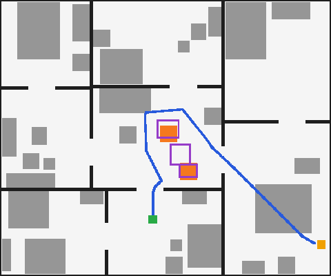

seed 1, ToF+YOLO. 주황 = 비행 중에 생긴 상자 더미·사람, 보라 테두리 = 드론이 찾은 장애물, 파랑 = 실제 궤적.

**결과 (Gazebo, 화면 없이).** 드론이 모든 가구를 아는 1단계 맵 6개에서, 비행마다 장애물을 최대 2개 만들어 ToF만·ToF+YOLO로 날렸습니다. 칸마다 결과 · 재계획 횟수 · 생긴 장애물(생길 때 경로를 따라 몇 m 앞이었는지, 그 뒤 최소 간격)입니다.

| seed | ToF만 | ToF + YOLO |
| --- | --- | --- |
| 7 | 성공 · 1 · 상자 2.2 m → 0.33 m | 성공 · 1 · 상자 2.2 m → 0.33 m |
| 1 | 성공 · 3 · 상자 2.2 m → 0.59, 사람 1.8 m → 0.31 | 성공 · 3 · 상자 2.2 m → 0.59, 사람 1.7 m → 0.41 (YOLO) |
| 2 | 성공 · 2 · 상자 2.6 m → 0.70, 사람 2.8 m → 0.45 | 성공 · 2 · 상자 2.6 m → 0.69, 사람 2.8 m → 0.30 |
| 3 | 성공 · 2 · 상자 1.8 m → 0.19 | 성공 · 4 · 상자 1.8 m → 0.51, 사람 2.9 m → 0.51 (YOLO) |
| 4 | 성공 · 2 · 상자 2.4 m → 0.31, 사람 1.8 m → 0.72 | 성공 · 2 · 상자 2.4 m → 0.33, 사람 1.8 m → 0.83 (YOLO) |
| 5 | 성공 · 3 · 상자 2.7 m → 0.35, 사람 2.9 m → 0.27 | 성공 · 4 · 상자 2.7 m → 0.34, 사람 2.9 m → 0.11 (YOLO) |

- **12번 모두 착륙**(목적지 오차 0.12–0.24 m, 비상 정지 0번). 비행 중 생긴 장애물 21개(상자 12, 사람 9)를 모두 찾아 피했고, 생긴 뒤 최소 간격은 0.11–0.83 m입니다.
- 장애물이 2개가 아니라 1개만 생긴 비행이 3번 있습니다. 경로가 짧거나(seed 7) 남은 경로에 조건에 맞는 자리가 없었습니다.
- YOLO는 사람 5명 중 4명을 1.5–2.3 m 앞에서 ToF보다 먼저 잡았습니다. seed 5에서는 같은 사람을 한 번 1.6 m 어긋난 자리(신뢰도 0.64)에도 넣어, 그 자리를 돌아가느라 재계획이 늘었습니다.
- 처음 시험에서는 생성기가 '실제 크기로 길이 남는지'만 봐서 12번 중 2번(seed 2, 3)이 막혀 멈췄습니다(ABORT). 드론이 어림한 장애물(ToF 한 점이라 위치가 0.4 m쯤 어긋나고 크게 잡힘) 때문에 드론 눈에는 길이 없었던 경우입니다. 시험 조건을 '크게 어림해도 길이 남는 자리'로 바로잡은 뒤의 결과가 위 표입니다. 실제로는 이런 좁은 곳이 생길 수 있으므로, ToF 위치 정확도는 VL53L5CX(8×8)로 높일 일입니다.

## 정답 위치 없이 날기 (위치 추정)

실기체(Tello EDU)에는 시뮬레이션 정답 위치가 없으므로, 비행 코드는 **Tello가 PC로 보내는 상태값만으로 추정한 위치**로 납니다. 마커(미션 패드·AprilTag)는 쓰지 않습니다.

```
[Tello 상태 문자열]  ──▶  pose_node.py  ──▶  /tt/pose_est  ──▶  mission_node.py
 Tello 드라이버                             (위치 + 불확실성 σ)
 (실기체 Tello 또는 gz_tello.py에서 받음. --direct면 sim_tello_state.py)
```

**Tello 상태값.** Tello는 UDP로 초당 약 10번 `pitch;roll;yaw;vgx;vgy;vgz;tof;h;bat;...` 문자열을 보냅니다. 속도는 dm/s 정수(0.1 m/s 단위), yaw는 1° 단위, 높이는 cm입니다. 시뮬레이션은 같은 문자열을 만들어 같은 토픽(`/tt/state`)으로 내므로, 위치 추정 노드는 실기체와 시뮬레이션을 구분하지 않습니다. 시뮬레이션이 흉내 내는 오차(모두 가정값): 속도 배율 오차(비행마다 1σ 3%), 속도 잡음 0.03 m/s, yaw 누적 1°/분, 도착 지연 30 ms.

**위치 추정.**
1. 속도 적분: 상태값의 속도를 yaw 방향으로 돌려 적분합니다. 출발 위치·방향은 `known_map.json`의 spawn을 씁니다(드론을 정해진 자리에 정해진 방향으로 놓고 시작).
   **옆 미끄럼 없음(11/06)**: 속도가 축마다 0.1 m/s 정수라 천천히 비스듬히 날면 작은 쪽 성분이 잘립니다(11/05 17:17 실기체 복도: 기수 16°로 0.2 m/s 직진하는 7초 내내 `vgx −2, vgy 0`, 위치는 0°로 가고 카메라는 −16°로 벽을 넣어 지도 벽이 경로 쪽으로 기울었다). 그래서 기수에 수직인 속도가 0.1 m/s 이하이고, 0.1 m/s 넘게 움직이며, 초당 30°보다 느리게 돌 때는 기수 쪽 성분만 씁니다(`EstimatorParams.no_slip`). Gazebo 기록 25개에서 이 규칙이 적용된 순간의 정답 옆 속도는 중앙 0.002 m/s였고, 지도 없이 다시 돌리면 위치 오차 평균 중앙 0.146 → 0.126 m, 최대 중앙 0.275 → 0.229 m입니다(지도 보정을 켜면 거의 같음). 시뮬레이션의 Tello 흉내는 반올림 전에 잡음을 섞어 옆 성분이 평균으로는 살아남으므로, 실기체보다 이 문제가 작게 나타납니다.
2. 지도 보정: 위치 후보 300개를 같이 움직이며, 벽·가구 속으로 들어가는 후보는 그 자리에 멈추게 하고 점수를 깎습니다. 전방 ToF가 그 후보 자리에서 지도대로 나와야 할 거리와 맞는지로 점수를 매깁니다. 지도에 없는 장애물은 측정을 '더 가깝게'만 만들므로 가까운 측정에는 약하게, 지도보다 먼 측정(벽을 뚫고 본 셈)에는 강하게 감점합니다.
3. 결과는 후보들의 평균 위치와 퍼진 정도(σ)입니다.

지도 보정에서 시험으로 찾아 고친 함정:
- **멈춰서 같은 측정을 거듭 믿기.** 지도에 없는 상자 앞에서 비상 정지한 뒤 0.33 m를 수십 번 재는 동안, '옆으로 비켜나 있으면 지도의 가구로 설명된다'는 엉뚱한 후보가 매번 조금씩 이겨 위치가 0.7 m 틀어지고 σ는 0.04 m로 줄었습니다(틀린 채 자신만만). 이제 지난 보정 뒤 5 cm 넘게 움직였거나 3° 넘게 돌았을 때만 다시 보정합니다.
- **지도에 없는 물체로 보정하기.** 후보 대부분(점수 합 80% 이상)이 '지도보다 확실히 가깝다'고 보는 측정은 지도에 없는 물체를 잰 것으로 보고 보정에 쓰지 않습니다. 이런 측정은 비행 코드가 장애물로 다룹니다.
- **모든 후보를 벽 앞에 세우기.** 벽 속으로 들어가는 후보는 벽 앞에 멈추게 했는데, 추정이 옆으로 조금 틀어진 채 문틀 옆을 지나가자 후보 전부가 막혀 추정만 그 자리에 섰고, 실제 드론은 2.9 m를 더 날아갔습니다(3단계 seed 3). 이제 막히는 후보가 점수 합으로 절반을 넘으면 멈추지 않고 속도대로 움직입니다(막힌 후보의 점수는 그대로 깎음). 기록된 비행 18개를 다시 돌려 보니 다른 비행은 결과가 같았습니다.
- **벽을 스친 진짜 위치를 지우기.** 처음에는 기체 반폭(0.09 m)만큼 부풀린 벽에 들어간 후보를 깎았는데, 실제 드론이 문틀을 2 cm 차로 스쳐 지나가자 진짜 위치 쪽 후보가 깎여 추정이 반대로 0.17 m 튀었습니다. 이제 후보 중심이 벽 속에 들어갈 때만 깎습니다.
- **가구를 꽉 찬 상자로 믿기.** 지도에서 가구는 바닥 면적 상자지만, ToF는 실제 모양(책장 선반 칸, 의자·책상 다리 사이)을 봐서 상자보다 멀게 재곤 합니다. 이것을 '벽을 뚫고 본 셈'으로 세게 감점하자, 출발점 옆 책장 때문에 위치가 0.18 m 밀렸습니다. 이제 벽·문 위 벽과 가구를 따로 두고, 가구보다 멀지만 벽보다 가까운 측정은 약하게만 감점합니다. 실제 건물에서도 똑같이 생길 일입니다.
- **빨리 돌면서 보정하기.** 상태값의 yaw는 30–130 ms 늦게 옵니다. 0.8 rad/s로 돌 때는 측정 방향이 최대 6° 틀리므로, 10°/s보다 빨리 돌 때는 ToF로 보정하지 않습니다(그보다 느릴 때는 최근 회전 속도로 ToF를 잰 순간의 yaw를 앞당겨 씁니다). 둘러보는 동안의 정보가 아까워 60°/s까지 앞당겨 쓰게도 해 봤지만, 기록된 비행 9개를 같은 입력으로 다시 돌려 보니 10°/s에서 끊는 쪽이 최대 오차가 작았습니다.
- **지도에 없는 물체라고 너무 쉽게 단정하기.** 후보 대부분이 '지도보다 가깝다'고 보는 측정도, 잰 자리 근처(0.25 m + 2σ)에 아는 벽·가구가 있으면 위치가 틀어진 채 그것을 잰 것일 수 있어 보정에 씁니다. 이를 버리자 위치가 0.5 m 틀어진 채 벽 앞에서 비상 정지만 30번 되풀이한 일이 있었습니다(3단계 seed 2).
- **비행 높이를 벗어나기.** 지도 보정은 비행 높이(1.0 m ± 0.25 m) 단면으로 합니다. 경로 계획기가 낮은 가구 위가 넓다고 1.35 m로 올라가자 비행 내내 보정이 끊겨 0.6 m 틀어졌습니다. 이제 계획기가 먼저 출발·도착 높이 ± 0.2 m 안에서 길을 찾고, 없을 때만 높이를 바꿉니다.

**비행 코드 쪽 안전장치.**
- σ가 0.6 m를 넘으면 그 자리에 착륙하고 ABORT로 끝냅니다.
- σ가 클수록 ToF 장애물 판정 여유를 넓힙니다.
- ToF가 닿은 자리 근처에 지도의 벽·문틀이 있으면 새 장애물로 넣지 않습니다. 위치가 0.2–0.4 m 틀어진 채 문을 지나며 문틀을 '새 장애물'로 착각해 문을 막아 버리던 문제를 이것으로 고쳤습니다.
- 그래도 길이 막히면, 아는 벽에 붙은 ToF 장애물을 빼고 한 번 더 계획합니다.
- 경로가 벽·문틀에서 떨어져 지나도록 계획합니다(1단계 절 '문·통로는 가운데로'). 추정 위치가 옆으로 0.17 m 틀어진 채 문을 지나 벽을 스치던 문제를 이것으로 줄였습니다.
- 마지막 점에 도착(0.15 m 안)하면 높이를 지킨 채 목적지 바로 위 5 cm 안으로 맞춘 뒤(최대 5초) 내립니다.
- 비상 정지(전방 0.35 m)한 자리에는 지도의 벽으로 설명되더라도 장애물을 넣습니다. 안 넣으면 같은 경로로 다시 가서 또 멈춥니다.
- **위치 다시 잡기 (RELOC).** 아는 벽·문틀 근처의 ToF 장애물 때문에 길이 막히거나(위치가 틀어져 아는 것을 새 장애물로 넣었을 수 있음), 웨이포인트에 닿지 못한 채 비상 정지를 세 번 하면, 위치 추정 노드에 후보를 0.3 m 넓게 흩으라고 하고(`/tt/relocalize`) 제자리에서 6°/s로 한 바퀴(약 60초) 돕니다. 위치 추정은 10°/s보다 느리게 돌 때만 ToF를 쓰므로 일부러 천천히 돕니다. 흩지 않으면 틀린 채 굳은 후보끼리만 겨뤄 다시 재도 바로잡히지 않습니다. 다 돌면 아는 벽에 붙은 ToF 장애물을 빼고 다시 계획합니다. 한 비행에 최대 3번이고, 지도상 지금 자리에서 1.1 m 안에 벽·가구가 두 방향(사분면) 넘게 보일 때만 합니다. 넓은 곳에서 했더니 잡히는 게 없어 σ만 0.62 m로 커져 위치를 잃고 그 자리에 착륙한 일이 있었습니다.
- 길이 끝내 없으면, 위치를 다시 잡기 전에 찾은 사람 둘레 여유를 0.35 → 0.15 m로 줄여 봅니다. 같은 사람이 조금씩 다른 자리로 여러 번 잡혀 사람 장애물이 통로를 막을 수 있기 때문입니다. 이때도 가까운 사람 인식과 ToF는 그대로 지킵니다.
  - 실험(단위 테스트, 4×3 m 방): 0.5 m 틀어진 채 σ 0.05 m로 굳은 추정이, 흩고 한 바퀴 돌면 10번 중 10번 0.06 m 안으로 돌아왔습니다(1.2 m 안에 벽 두 개가 보일 때). 벽이 하나만 보이는 자리에서는 그 벽을 따라가는 방향을 알 수 없어 0.09–0.55 m로 남았습니다.
- 경유점 높이는 10 cm 칸 중심(0.95·1.05 m)이 아니라 비행 높이(1.0 m)에 맞춥니다. 0.95 m로 날다가 지도에 없는 0.96 m 의자에 닿은 일이 있었습니다.

**추정기 값 바꿔 보기 (Gazebo 없이).** 비행할 때 `pose_node.py`가 받은 상태 문자열과 ToF를 `pose_inputs.csv`에 그대로 남깁니다. `tools/replay_pose.py`는 이것을 같은 순서로 추정기에 다시 넣으므로 실비행의 추정을 그대로 재현하고, 값을 바꾸면 그 비행에서 어떻게 달라졌을지 비행 하나에 몇 초 만에 볼 수 있습니다. 실기체 비행 기록도 같은 형식으로 남기면 똑같이 쓸 수 있습니다.

```bash
python3 tools/replay_pose.py worlds/s3_stage2 --truth worlds/s3_stage2/truth_log.csv --inputs worlds/s3_stage2/pose_inputs.csv
python3 tools/replay_pose.py worlds/s3_stage2 --truth ... --inputs ... --set tof_max_yaw_rate=1.0   # 값 바꿔 보기
```

**평가.** 충돌·목적지 오차는 정답 기록(`truth_log.csv`)으로 재고, 비행 코드가 믿은 위치와 비교해 위치 추정 오차를 냅니다. `flight.png`에 하늘색(추정)과 파랑(실제) 궤적을 함께 그립니다.

**결과 (Gazebo, 화면 없이, 최종 코드).** 6개 맵(seed 1–5, 7). '정답 위치 없이'는 비행 코드가 추정 위치만 쓰고, 충돌·목적지 오차는 정답 궤적으로 잽니다. 칸마다 결과 · 목적지 오차 · 장애물 최소 간격(드론 외곽 기준) · 위치 추정 오차 최대(2단계는 재계획 횟수도).

| seed | 1단계 정답 위치 없이 | 2단계 정답 위치 없이 (ToF만) | 1단계 정답 위치 (비교) | 2단계 정답 위치 (비교, ToF만) |
| --- | --- | --- | --- | --- |
| 7 | 성공 · 0.04 m · 0.24 m · 0.18 m | 성공 · 0.12 m · 0.05 m · 0.18 m · 1 | 성공 · 0.00 m · 0.24 m | 성공 · 0.00 m · 0.06 m · 1 |
| 1 | 성공 · 0.17 m · 0.30 m · 0.19 m | 성공 · 0.17 m · 0.17 m · 0.20 m · 1 | 성공 · 0.00 m · 0.22 m | 성공 · 0.00 m · 0.16 m · 1 |
| 2 | 성공 · 0.06 m · 0.22 m · 0.23 m | 성공 · 0.16 m · 0.23 m · 0.25 m · 1 | 성공 · 0.00 m · 0.31 m | 성공 · 0.00 m · 0.35 m · 1 |
| 3 | 성공 · 0.22 m · 0.28 m · 0.25 m | 성공 · 0.10 m · 0.14 m · 0.13 m · 2 | 성공 · 0.00 m · 0.27 m | 성공 · 0.00 m · 0.24 m · 2 |
| 4 | 성공 · 0.07 m · 0.26 m · 0.22 m | 성공 · 0.06 m · 0.01 m · 0.32 m · 3 | 성공 · 0.00 m · 0.19 m | 성공 · 0.00 m · 0.02 m · 2 |
| 5 | 성공 · 0.23 m · 0.14 m · 0.25 m | 성공 · 0.15 m · 0.10 m · 0.20 m · 3 | 성공 · 0.00 m · 0.18 m | 성공 · 0.00 m · 0.15 m · 4 |

- **정답 위치 없이 12번 중 12번 성공**(1·2단계 각 6/6). 목적지 오차 0.04–0.23 m(성공 기준 0.3 m), 위치 추정 오차는 비행 중 최대 0.13–0.32 m였습니다. 2단계 열은 위치 다시 잡기(RELOC)를 넣은 최종 코드 결과이고(6번 모두 다시 잡을 일은 없었음), 1단계 열은 그 전 코드 결과입니다(1단계에는 다시 잡는 조건인 계획 실패·반복 비상 정지가 생기지 않음). 그 뒤 3단계 시험에서 고친 위치 추정의 벽 막힘 규칙은, 이 12번의 기록된 입력으로 다시 돌려 추정이 그대로임을 확인했습니다.
- **처음에는 1단계도 6번 중 3번만 성공**했습니다. 경로가 문틀에 붙어 지나다 추정 위치가 옆으로 0.17 m 틀어지자 벽을 스쳤고(seed 2), 위치 추정 오차가 0.42 m까지 커졌습니다(seed 5). 1단계 절의 '문·통로는 가운데로', 착륙 전 위치 맞추기, 위 '함정' 6가지를 고친 뒤의 결과가 위 표입니다.
- **최소 간격이 0.1 m보다 작은 2단계 비행 2개는 위치 추정 탓이 아닙니다.** 정답 위치로 날아도 같은 곳에서 비슷하게 작았습니다. seed 7은 지도에 없는 상자 더미가 ToF 시야(±12.5°) 바로 바깥으로 지나갔고(ToF는 끝까지 '없음'), seed 4는 지도에 없는 0.96 m 의자 위를 1.0 m 높이로 지났습니다. 넓은 시야 센서(VL53L5CX)와 비행 높이 1.2 m가 답입니다('알려진 한계' 참고).
- 정답 위치로는 목적지 오차가 0.00 m입니다(착륙 전에 목적지 위 5 cm 안으로 맞추므로). 정답 위치 없이 남는 0.04–0.23 m는 위치 추정 오차 그대로입니다.

| 2단계 seed 3, 정답 위치 없이 | 1단계 seed 5, 정답 위치 없이 |
| --- | --- |
| 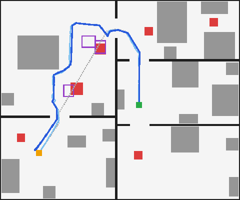 | 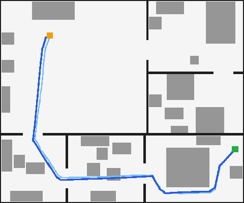 |

하늘색 = 비행 코드가 믿은 추정 궤적, 파랑 = 실제 궤적, 빨강 = 지도에 없던 물건, 보라 테두리 = 비행 중 찾은 장애물, 회색 점선 = 받은 지도로 처음 짠 경로.

**실기체에서 확인할 것.** Tello 상태값의 규약은 공개 자료로 확실하지 않아 `autonomy/tello_state.py`의 `CONVENTION`에 가정으로 두었습니다. 도착하면 다음을 확인해 바꿉니다.
1. 이륙 → `cw 90` 뒤 yaw 값이 +90인지 -90인지 (`yaw_sign`)
2. `cw 90` 뒤 `forward 50` 동안 vgx·vgy 중 어느 쪽이 변하는지 (`vel_frame`: 기체 기준이면 body)
3. `right 50` 동안 vgy 부호 (`vy_sign`)
4. 줄자로 잰 실제 이동 거리와 속도 적분 거리의 비 (속도 배율 오차)

## 실기체와 같은 명령 경로 (Tello 드라이버)

실기체에서 비행 노드가 기체를 움직이는 길은 Tello SDK 명령(`rc a b c d`, `takeoff`, `land`)뿐입니다.
시뮬레이션도 기본으로 이 길을 그대로 거칩니다. 드라이버는 실기체와 같은 코드이고 주소·포트만 다릅니다.

```
mission_node ─/tt/cmd_vel(m/s)·/tt/flight_cmd─▶ Tello 드라이버 ─UDP: rc(20Hz)·takeoff·land─▶ gz_tello.py ─/tt/sim/cmd_vel─▶ Gazebo
pose_node    ◀─────────/tt/state──────────────  (modules/autonomy/  ◀─UDP: 상태 패킷 10Hz─────  (Tello 흉내)
                                                 tello_driver)
실기체: gz_tello.py 자리에 Tello EDU(192.168.10.1:8889, 상태 8890)
```

- **드라이버** ([modules/autonomy/tello_driver](../../modules/autonomy/tello_driver/README.md)): 속도 명령을 rc로 바꿔 ±30 안으로
  줄입니다(수평은 방향을 지킨 채). 이륙 전 점검·데드맨(0.3초)·높이 상한·자동 착륙은 팀 연결 모듈(tello_link)의 `FlightController`를
  그대로 쓰고, 속도 명령이 2초 끊기면 착륙합니다.
- **비행 노드** (`driver:=true`): 이륙은 드라이버에 `takeoff`를 요청합니다. Tello는 약 0.8 m까지 스스로 오른 뒤 응답하므로,
  그다음 비행 높이 1.0 m까지는 속도로 오릅니다. 착륙은 목적지 위에 맞춘 뒤 `land`를 요청합니다. 드라이버가 스스로 내리면(배터리·상태 끊김)
  ABORT로 끝내고, ABORT가 되면 공중에 머물지 않고 그 자리에 착륙을 요청합니다.
- **gz_tello.py** (`simdrone/tello_emu.py`): Gazebo 드론을 UDP로 말하는 Tello처럼 흉내 냅니다. 모두 가정값이라 실기체로 다시 잽니다.
  `land`를 받아도 마지막 rc의 수평·회전은 내려오는 동안 그대로 따릅니다(11/12 13:58 실기체에서 잰 것: `rc 0 -36 0 0` 뒤의 `land`로 3.5초에
  0.83 m 뒤로 감). 스틱을 0으로 되돌리는 것은 드라이버(`FlightController.land`)가 `land` 앞에 보내는 `rc 0 0 0 0`입니다.

| 흉내 | 값 | 실측 (2026-10-23 수동 비행, tello_link README) |
| --- | --- | --- |
| rc → 속도 | rc 100 = 수평 1.0 m/s, 상하 1.0 m/s, 회전 100°/s. 시상수 0.3 s(회전 0.15 s)로 따라감 | rc ±30에서 vgx −2~3 (dm/s면 0.2–0.3 m/s), 줄자 측정 전 |
| 이륙 | 모터 2 s → 0.25 m/s로 0.8 m → 0.5 s 뒤 `ok` (약 6 s) | 응답까지 8.6 s, 약 80 cm |
| 착륙 | 0.3 m/s로 내려간 뒤 `ok` | 3.2–4.6 s |
| 상태 패킷 | 10Hz, 지연 30 ms, 속도·yaw·높이 잡음 (`--direct`의 sim_tello_state.py와 같은 흉내) | 9.9Hz |
| 무명령 착륙 | 비행 중 15 s 동안 명령이 없으면 착륙 | Tello 동작(실측 전) |
| 닿음 반력 `agx`·`agy` (11/13) | 건 수평 속도 명령보다 실제로 덜 가면(무엇에 막힘) 그 차이에서 0.05 m/s를 뺀 만큼 × 2.5 g를 반대쪽 가속으로 낸다(0.2 m/s로 가다 막히면 0.375 g, 잡음 10 mg). 기울기는 늘 0, Tello가 제자리를 지키려 닿은 쪽으로 계속 미는 것은 흉내 내지 않음 | 정상 비행 최대 93 mg, 부딪힘 0.65–3.1 g, 벽에 기대어 밀 때 0.1–0.4 g (11/13 실기체) |

비교로 예전처럼 속도를 Gazebo에 바로 넣으려면 `--direct`(run_mission.sh·watch_mission.sh) 또는 `link:=direct`(launch)를 줍니다.

**시뮬레이션 결과** (드라이버 경로, 2026-10-26, 1·2단계 6개 맵씩, YOLO 없이 ToF만): 12번 모두 드라이버의 `takeoff`로 떠서
`land`로 내렸고 장애물에 닿은 비행은 없었습니다(최소 간격 0.09 m). 9번 성공했고, 3번은 착륙 위치가 목적지에서 0.3 m 이상
떨어져 실패로 판정했습니다. 세 번 모두 착륙할 때 위치 추정이 0.27–0.42 m 틀어져 있었습니다. 경로 추종이나 이착륙이 아니라
위치 추정 쪽 문제로 보고 원인을 찾는 중입니다. 같은 맵을 예전 경로(속도를 Gazebo에 바로)로 날렸을 때는 12번 모두 성공,
목적지 오차 0.04–0.23 m였습니다. 드라이버 경로는 rc 상한 ±30 때문에 최대 속도가 0.4 → 0.3 m/s로 줄어 비행이 길어지고,
rc 지연(가정 0.3 s)이 더해졌습니다.

| 맵 | 결과 | 목적지 오차 (m) | 위치 추정 오차 최대 / 착륙 때 (m) | 최소 간격 (m) | 비행 시간 (s) |
| --- | --- | --- | --- | --- | --- |
| seed 1, 1단계 | 실패 | 0.30 | 0.30 / 0.27 | 0.14 | 64 |
| seed 2, 1단계 | 실패 | 0.45 | 0.42 / 0.42 | 0.20 | 78 |
| seed 3, 1단계 | 성공 | 0.25 | 0.27 / 0.27 | 0.28 | 63 |
| seed 4, 1단계 | 성공 | 0.04 | 0.20 / 0.01 | 0.22 | 56 |
| seed 5, 1단계 | 성공 | 0.26 | 0.26 / 0.26 | 0.18 | 85 |
| seed 7, 1단계 | 성공 | 0.03 | 0.15 / 0.08 | 0.23 | 39 |
| seed 1, 2단계 | 성공 | 0.25 | 0.27 / 0.22 | 0.09 | 79 |
| seed 2, 2단계 | 성공 | 0.15 | 0.21 / 0.21 | 0.23 | 94 |
| seed 3, 2단계 | 실패 | 0.40 | 0.49 / 0.38 | 0.17 | 130 |
| seed 4, 2단계 | 성공 | 0.09 | 0.16 / 0.06 | 0.21 | 69 |
| seed 5, 2단계 | 성공 | 0.23 | 0.31 / 0.23 | 0.18 | 108 |
| seed 7, 2단계 | 성공 | 0.14 | 0.20 / 0.17 | 0.10 | 41 |

실기체 첫 시험(이륙 → 제자리 → 앞으로 → 착륙)은 `modules/autonomy/tello_driver/hover_check.py`로 하며, Gazebo에서도 같은 드라이버로
돌려 확인했습니다(드라이버 README의 '실기체에서 쓰기').

### 자율비행 웹 화면

자율비행하는 동안 드론 카메라 영상과 지도(벽·가구·계획 경로·지나온 길·찾은 장애물·드론 위치)를 브라우저로 보고,
[자율비행 시작]·[착륙]·[비상 정지]를 누르는 화면입니다([modules/autonomy/autonomy_web](../../modules/autonomy/autonomy_web/README.md)).
팀 Tello 점검·조작 화면의 모양과 이륙 전 점검·운용자 확인·Esc 비상 정지를 그대로 가져왔습니다.
`web:=true`면 비행 노드는 위치를 잡은 뒤 화면의 시작 버튼을 기다립니다(READY).

```bash
ros2 launch launch/mission.launch.py world_dir:=$PWD/worlds/s7_stage2 headless:=true web:=true detect:=true   # 시뮬레이션
ros2 launch launch/real.launch.py                                                                              # 실기체 (탐색)
```

실습실 실기체 자율비행 안내는 [rooms/lab/README.md](rooms/lab/README.md)에 있습니다(켜는 절차, 탐색 비행, 시험 기록).
**실기체는 탐색 하나만 합니다**(2026-11-03 결정): 빈 지도 + 카메라 깊이로 지도를 만들며 YOLO로 사람을 찾는다(아래 4단계와 같은 길).
`mode:=route`(경로 비행)·`wander`(둘러보기)는 실기체에서 뺐고 Gazebo(`mission.launch.py`, `scripts/run_mission.sh --wander`)에만 남았습니다.
YOLO 가중치·`~/venvs/tt`가 없으면 켜지지 않고, YOLO 결과가 와야 웹 화면의 [자율비행 시작]이 켜집니다.
확장 키트 전방 ToF는 드라이버가 `EXT tof?`로 물어 `/tt/tof_front`로 냅니다(`real.launch.py front_tof:=true`, 기본).
시뮬레이션에서 같은 길을 보려면 `tof:=ext`(또는 `run_mission.sh --ext-tof`)로 돌립니다.

브라우저로 http://localhost:8080 을 엽니다. Gazebo 2단계 seed 7에서 화면의 시작 버튼으로 이륙 → 재계획 3번 → 목적지 0.03 m(추정 위치)
착륙까지 확인했고, 카메라 원본·YOLO 탐지 영상과 지도가 비행 중 갱신되는 것을 봤습니다. 실기체는 2026-10-27에 `real.launch.py`로 첫 자율 이륙까지 했고
(이륙 응답 8.8 s, 전방 ToF 506회 응답), 그 뒤 실기체 비행은 탐색으로 날렸습니다(날짜별 요약은 rooms/lab/README.md 8절).

## 사람 찾기 탐색 (목표 3단계)

목적지가 없는 지도(3단계)에서는 스스로 돌며 사람을 찾고, 끝나면 출발점으로 돌아와 착륙합니다.

1. **본 곳 지도**: 바닥을 25 cm 칸으로 나누고, 카메라 시야(화각 82.6°, 4 m 안)에 벽·가구에 가리지 않고 들어온 칸을 '봤음'으로 표시합니다. 날아가는 동안 초당 5번 갱신합니다.
2. **다음 볼 자리**: 0.75 m 간격 후보 중에서 (그 자리에서 둘러보면 새로 보일 칸 수) ÷ (1 + 가는 거리/3 m)가 가장 큰 곳으로 갑니다. 이미 다녀온 자리와 길이 없던 자리는 빼고 고릅니다.
3. **둘러보기**: 도착하면 안 본 칸이 가장 많은 방향으로 기수를 돌립니다. 볼 게 없을 때까지(최대 6번) 되풀이합니다.
4. **사람 기록**: YOLO가 잡은 사람의 발 위치로 사람 위치를 구하고(발이 잘린 가까운 사람의 어림 위치는 0.5 m쯤 틀려 피하는 데만 씁니다), 1 m 안이면 같은 사람으로 합칩니다. 평균이 옮겨 가 다른 항목과 1 m 안이 되면 그것도 합치고, 지도의 가구 속에 찍힌 위치(발이 가구에 가려 생긴 오차)는 버립니다. 확정된 사람은 몸 크기 0.5 m + 여유 0.35 m로 **지우지 않는 장애물**이 됩니다. 길이 막힐 때 카메라 장애물을 빼는 과정에서 사람까지 빠져, 돌아오는 길에 사람 옆을 스친 일이 있었기 때문입니다. 두 번 넘게 잡혔거나 신뢰도 0.7 이상으로 잡힌 사람만 `people.json`의 `people`에 넣고, 한 번 흐릿하게 잡힌 것은 `unconfirmed`에 따로 둡니다. 사람은 장애물로도 피합니다.
5. **끝내기**: 더 볼 곳이 없거나 탐색 시간(기본 300초)이 지나면 출발점으로 돌아와 착륙합니다. 다만 '더 볼 곳이 없다'가 찾은 장애물 때문일 수 있어(문 옆에 선 사람을 크게 어림해 문이 막힘), 그때는 장애물 여유를 줄여 보고, 그래도 없으면 카메라로만 본 장애물을 빼고 다시 고릅니다.

```bash
python3 generate_world.py --seed 7 --stage 3
bash scripts/run_mission.sh worlds/s7_stage3 --detect --search-time 300 --timeout 700
bash scripts/watch_mission.sh worlds/s7_stage3 --detect
```

**결과 (Gazebo, 화면 없이, 정답 위치 없이 + YOLO, 최종 코드).** 6개 맵(seed 1–5, 7), 맵마다 사람 3명, 탐색 시간 300초(위치 다시 잡기 시간을 감안해 시험 제한 900초). '찾은 위치 오차'는 찾은 사람마다 실제 위치와의 거리, '복귀'는 착륙한 곳과 출발점의 거리입니다.

| seed | 결과 | 찾은 사람 | 엉뚱한 자리 | 본 곳 | 탐색 시간 | 처음·마지막 사람까지 | 찾은 위치 오차 | 복귀 | 최소 간격 | 위치 추정 오차 최대 |
| --- | --- | --- | --- | --- | --- | --- | --- | --- | --- | --- |
| 7 | 성공 | 3/3 | 1 | 98% | 360 s | 25·326 s | 0.00–0.13 m | 0.27 m | 0.11 m | 0.28 m |
| 1 | 성공 | 3/3 | 0 | 83% | 254 s | 46·92 s | 0.16–0.25 m | 0.13 m | 0.01 m | 0.37 m |
| 2 | 성공 | 3/3 | 0 | 99% | 315 s | 1·52 s | 0.05–0.11 m | 0.15 m | 0.08 m | 0.33 m |
| 3 | 성공 | 3/3 | 0 | 97% | 346 s | 26·119 s | 0.07–0.14 m | 0.11 m | 0.13 m | 0.52 m |
| 4 | 성공 | 3/3 | 0 | 99% | 289 s | 2·54 s | 0.10–0.13 m | 0.06 m | 0.05 m | 0.47 m |
| 5 | 성공 | 3/3 | 1 | 97% | 346 s | 54·208 s | 0.10–0.52 m | 0.21 m | 0.12 m | 0.33 m |

- **6번 모두 성공**: 사람 18명을 모두 찾았고(찾은 위치 오차 0.00–0.52 m), 탐색을 마치고 출발점 0.06–0.27 m 안에 내렸습니다. 사람·벽·가구와 닿은 비행은 없습니다(최소 간격 0.01–0.13 m).
- **seed 1은 83%만 보았습니다.** 서쪽 방으로 가는 통로 입구에 사람이 서 있어, 찾은 사람 둘레(0.6 m)를 비우니 통로를 지날 수 없었습니다. 사람 옆을 비집고 지나가지 않는 쪽을 택한 결과입니다.
- **엉뚱한 자리 2개**는 실제 사람에서 1 m 남짓 떨어진 중복 기록입니다.
- **위치 다시 잡기는 이 6번에서 한 번도 실행되지 않았습니다.** seed 3이 돌아오지 못하던 진짜 원인은 '모든 후보를 벽 앞에 세우기'(위 함정)였고, 그것을 고치자 길이 막히는 일이 없어졌습니다. 위치 다시 잡기가 실제 비행에서 위치를 바로잡는지는 아직 Gazebo로 확인하지 못했고 단위 테스트로만 확인했습니다. 앞선 시험에서 넓은 곳에서 실행됐을 때는 오히려 위치를 잃었고, 그래서 '벽이 두 방향 넘게 보일 때만' 조건을 넣었습니다.
- 이 결과가 나오기까지 3단계에서 고친 것: 가까운 사람 바로 피하기(발이 잘린 사람, 벽·가구 옆 사람, 앞뒤가 안 맞는 상자 버리기), 모퉁이에서 돈 뒤 0.6초 보고 출발, 찾은 사람을 지우지 않는 장애물로 넣기, 탐색 중 갈 곳이 막혔을 때 다시 시도, 탐색 중 길이 0인 경로를 '도착'으로 보기, 비상 정지한 자리에 장애물 넣기, 위치 추정의 벽 막힘 규칙. 이 수정들 전에는 같은 맵들에서 사람과 네 번 부딪히고 두 번 돌아오지 못했습니다.

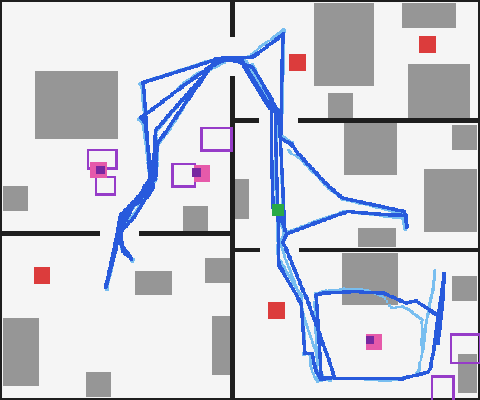

seed 3. 하늘색 = 추정 궤적, 파랑 = 실제 궤적, 분홍 = 사람, 보라 점 = 찾은 사람 위치, 보라 테두리 = 비행 중 찾은 장애물, 빨강 = 지도에 없던 물건, 초록 = 출발점.

## 지도 없이 지도 만들며 탐색 (목표 4단계)

드론에게 영역 경계와 출발점만 주고(벽·가구 정보 없음), 카메라 영상으로 3D 지도를 만들면서 돌아다니며 사람을 찾습니다. 지도에는 장애물과 찾은 사람이 표시됩니다. 위치는 지도가 없으므로 Tello 상태값의 속도 적분만으로 추정합니다.
실기체도 같은 길로 띄웁니다: `ros2 launch launch/real.launch.py`(빈 지도를 기록 폴더에 만들고, 깊이·YOLO 노드는 드라이버 원본 영상 `/tt/camera/image_raw`에 붙음).
실습실 월드로 미리 보려면 `rooms/lab/make_maps.sh --sim` 뒤 `run_mission.sh worlds/lab_explore --ext-tof --speed 0.2 --depth --localize`(월드는 가구 그대로, 드론은 벽 없는 `explore_lab.json`을 받음).

```
카메라 영상 ──▶ depth_node.py ──▶ /tt/depth ──┐
 (175 ms 지연)   단안 깊이 추정 (GPU)           ├──▶ mission_node.py: 3D 복셀 지도 ──▶ 경계 골라 탐색
전방 ToF(1.2 m) ─────────────────────────────┤        (autonomy/camera_map.py)     camera_map.npz
YOLO ──▶ /tt/detections ──▶ 찾은 사람 ────────┘                                       people.json
```

**카메라 한 장으로 거리 재기.** Tello에는 깊이 카메라가 없으므로, 영상 한 장에서 거리를 추정하는 모델(Depth Anything V2, 실내 미터 단위 Small, Apache-2.0)을 YOLO처럼 PC GPU에서 돌립니다(`perception/depth.py`). 처음 실행할 때 Hugging Face에서 모델(약 100 MB)을 내려받습니다.
- 그대로 쓰면 실제보다 약 1.5배 멀게 추정했습니다. 이 모델은 화각 60° 카메라로 학습해서, 화각이 넓은 Tello 카메라(82.6°)에서는 물체가 작게 보여 멀다고 판단하기 때문입니다. 깊이는 초점거리에 비례하므로 tan(30°)/tan(41.3°) = 0.66을 곱해 맞춥니다. 실기체에서는 캘리브레이션한 화각을 씁니다.
- 정확도(`tools/eval_depth.py`: 드론을 맵의 빈 자리 30곳에 순간이동시켜, 평가 전용 정답 깊이 카메라와 비교):

| 맵 | 평균 상대 오차 | 1.25배 안에 든 화소 | 1 m 안 | 1–2 m | 2–4 m | 4–8 m | 한 장 추정 시간 |
| --- | --- | --- | --- | --- | --- | --- | --- |
| seed 7 (1단계) | 18% (화각 보정 전 57%) | 78% (보정 전 9%) | 30% | 14% | 8% | 9% | 49 ms |
| seed 3 (3단계) | 13% | 79% | 27% | 14% | 7% | 10% | 86 ms |

  1 m 안(밋밋한 벽을 코앞에서 볼 때)은 약해서 0.3 m 안은 버리고, 가까운 곳은 ToF 측정점을 그대로 지도에 넣습니다. ToF 한 점으로 영상 전체의 배율을 맞추는 방법도 해 봤지만 먼 곳이 오히려 나빠져 쓰지 않습니다.
- **장면마다 배율 맞추기 (바닥).** 문 앞 등 150장을 저장해(`tools/eval_depth.py --doors --save-raw`) 보니 오차의 큰 부분이 '장면마다 전체 배율이 흔들리는 것'이었습니다(장면별 배율 0.98–1.24). 비행 높이를 알면 영상 아래쪽 바닥이 있어야 할 거리를 알므로, 바닥으로 보이는 화소로 장면마다 배율을 맞춥니다(`perception/depth.py`의 `floor_scale`). 바닥이 화면의 5% 넘게 보일 때만 맞추고, 아니면 직전 배율을 씁니다. 실기체에서도 하방 거리 센서의 높이만 있으면 그대로 됩니다.
  - 효과: 저장한 장면으로 만든 지도에서 헛 장애물 칸이 seed 1·2·3에서 220 → 83, 273 → 47, 542 → 185개로 줄었습니다(진짜 장애물 칸은 거의 그대로).
  - 남은 치우침: 가까울수록 짧게 추정합니다(추정 0.3–1.2 m에서 실제는 1.2–1.3배, 2 m 넘으면 1.02–1.05배). 시뮬레이션 영상에 맞춘 보정 곡선은 실기체에서 틀릴 수 있어 쓰지 않고, 아래처럼 가까운 추정은 막힘으로 찍지 않습니다.

**지도 만들기** (`autonomy/camera_map.py`, 10 cm 복셀, 칸마다 막힘 점수):
- 깊이 영상(240×180)에서 6화소마다 광선을 긋습니다. 지나간 칸은 '비어 있음'(−0.25), 끝 칸은 '막힘'(+0.85) 쪽으로 점수를 옮기고, 한 번도 광선이 지나지 않은 칸은 '모름'입니다. 4 m까지만 믿습니다.
- 높이 0.3 m 아래에 닿은 점은 바닥으로 봅니다(먼 바닥의 깊이 오차가 0.15 m 위로 찍혀 빈 바닥에 점 장애물이 생겼음).
- 1 m보다 가까운 추정은 그 거리까지 비우기만 하고 막힘으로 찍지 않습니다(짧게 추정해 벽 앞 빈 곳에 헛 장애물이 생겼음). 가까운 정면은 ToF가 맡습니다.
- 깊이 경계 화소(3화소 창 안에서 거리가 1.3배 넘게 차이)는 가까운 쪽 거리까지만 비우고, 그 화소가 경계의 가까운 쪽(문틀 자체)일 때만 막힘을 찍습니다. 단안 깊이는 문틀(가까움)과 그 너머(멂) 사이 화소에 중간 거리를 내서, 문 바로 뒤 빈 곳에 헛 장애물이 생겼습니다. 처음에는 경계 화소를 아예 안 찍었더니 벽 끝(문틀)이 늘 경계라 지도에서 빠져, 위치가 정확한데도 문틀에 2.5 cm 닿았습니다(seed 1, 비행 기록으로 그 순간의 지도를 다시 만들어 확인).
- 드론이 지나간 자리는 비어 있고, 그 길은 계획 지도에서 항상 열어 둡니다. 지나온 뒤 아래에 탁자가 보이는 식으로 주변이 통째로 막혀, 돌아갈 길이 사라진 적이 있습니다.

**계획과 탐색:**
- 막힌 칸은 0.25 m, 모르는 칸은 0.1 m 부풀려 막습니다. 그래서 본 적 있는 빈 곳으로만 날아갑니다.
- 높이 0.3–1.3 m에 막힌 칸이 있는 자리는 위아래 전체를 막습니다(가구 위로 날지 않기). 카메라에는 얇은 모니터 말고는 책상 위가 비어 보여, 그 위로 날다가 모니터가 있는 책상(1.25 m)·TV장(1.2 m)에 닿았기 때문입니다.
- 이륙하면 먼저 제자리에서 둘러봅니다. 그 뒤 '아는 빈 칸'과 '모르는 칸'의 경계(frontier) 무리 중 (무리 크기) ÷ (1 + 거리/3 m)가 큰 곳으로 가서, 모르는 칸이 많이 보이는 쪽으로 둘러보기를 되풀이합니다. 방향마다 1초씩 멈춰 깊이 영상이 지도에 들어오게 합니다.
- 갈 수 있는 경계가 없으면 먼저 지도 여유를 0.4 m → 0.2 m(11/02까지 0.3 m)로 줄여 다시 찾습니다(그 자리까지만 씀. 파라미터 `map_radius`·`map_radius_tight`. 2026-10-28까지는 0.25 → 0.15였는데, 가구를 모르는 실습실 월드에서 0.03–0.06 m까지 붙어 올렸습니다. 실제 간격 ≈ 여유 − 드론 반폭 0.09 m − 위치 오차). 그래도 없으면 '막힌 경계' 가까이(2.5 m 안) 가서 그쪽을 3초 동안 봅니다. 멀리서 본 헛 장애물이 문·통로를 막은 경우가 많아, 가까이서 보는 깊이 영상이 그 칸을 다시 비웁니다. 고치기 전에는 seed 1·2·3·5가 탐색 4–55초 만에 '더 볼 곳 없음'으로 돌아왔습니다.
- 더 볼 경계가 없거나 300초가 지나면 출발점으로 돌아와 착륙합니다. 사람은 3단계와 같은 방식으로 찾고 피합니다.

**위치 바로잡기 (카메라 지도로, `--localize`)** (`autonomy/scan_match.py`): 지도가 없으면 위치는 Tello 속도 적분뿐이라 3–5분 탐색에서 0.5–0.9 m 틀어져, 문틀에 닿거나 출발점에서 떨어져 내렸습니다(속도 배율 오차, yaw가 분당 약 1° 틀어짐).
- 0.5초마다 깊이 영상의 막힌 점(1–4 m, 높이 0.3–1.8 m)을 **20초 넘게 지난** 평면 막힘 지도에 대어 봅니다(방금 그린 지도는 지금의 위치 오차를 그대로 담고 있음). 위치 ±0.3 m·방향 ±5°·깊이 배율 0.96–1.04 안에서 가장 잘 붙는 보정을 찾아 **15%만** 반영합니다. 복도처럼 점수가 판판한 방향, 찾는 범위 끝에 걸린 보정(벽 일부만 본 지도에서 생김), 예전 지도에서 못 본 칸에 떨어진 점, 깊이 경계의 중간 화소는 쓰지 않습니다.
- 맞추기 한 번은 약 0.2 s라 비행 노드에서는 따로 도는 스레드에서 합니다(조종 주기 50 ms가 늘어지지 않음을 확인). 비행 노드는 위치 추정 노드 값에 '추정 → 지도 좌표' 보정을 곱해 쓰고, 비행 기록(`flight_log.csv`)의 `corr_x, corr_y, corr_yaw`가 그 보정입니다.
- 출발점에 돌아오면 내리기 전에 제자리에서 한 바퀴(15°/s) 돌며 맞춘 뒤, 고친 위치로 출발점에 다시 맞춰 내립니다. 이때는 이륙 30초 뒤(출발점 둘레를 둘러본 뒤, 위치 오차가 거의 없을 때) 떠 둔 지도에 대고, 찾는 범위를 ±0.6 m로 넓히고 절반씩 반영합니다. 보통 범위(±0.3 m)로는 0.4 m 틀어진 채 돌아왔을 때 맞춤이 모두 범위 끝에 걸려 버려졌습니다(seed 4). 기록 5개를 다시 돌려 보면 내리기 직전 위치 오차가 평균 0.21 → 0.13 m, 최대 0.41 → 0.17 m로 줄었습니다.
- 추정 위치가 실제보다 50–58 ms 늦게 나와, 돌 때 깊이 영상이 약 2.4° 틀어져 지도에 들어갔습니다. 영상을 찍은 시각 + 0.05 s의 추정 위치(보간)를 씁니다(`pose_lag`, 실기체에서는 제자리 회전으로 다시 잼).

**시뮬레이터 없이 고치기: 비행 기록 → 다시 돌리기.** `run_mission.sh --record`로 지도에 넣은 깊이 영상·추정 위치·ToF를 남기고(`autonomy/flight_record.py`, 비행 하나 약 65 MB), `tools/replay_map.py`로 같은 순서·같은 방법으로 다시 넣어 지도와 위치 맞추기를 잽니다(비행 하나 20–60초). 기록대로 다시 만든 지도는 실제 비행의 점수와 같았습니다(seed 1: 막힘 정확도 93%/93%, 비어 있다고 잘못 본 곳 20.3%/20.3%). 비행 경로는 기록 그대로라 위치 맞추기가 경로를 바꾸는 효과는 실제 비행으로 따로 확인합니다.
- 맞추기 한 번은 정답 위치로 만든 지도에 대어도 약 0.13 m 흔들립니다. 찾은 보정을 반씩 반영하던 처음 값은 이 흔들림이 쌓여 속도 적분만보다 나빴고, 15%씩 반영해 여러 번의 평균으로 고치니 나아졌습니다.
- 깊이 배율을 함께 찾지 않으면 장면 배율 흔들림(3–4%)이 위치 보정으로 새어 나빠졌습니다(seed 4: 0.27 → 0.31 m). 점을 250개에서 120개로 줄여도 나빠져, 계산이 무거운 대신 스레드로 돌립니다.
- 속도 적분 오차는 대부분 출발점을 중심으로 '늘이고(속도 배율) 돌린(방향 오차)' 꼴입니다(기록 6개를 이 꼴로 맞추면 남는 오차 0.07–0.14 m). 그래서 배율·방향·위치를 칼만 거르개로 함께 배우는 방식(`model='drift'`)도 만들었지만, 맞추기 결과의 치우침이 지도 전체를 늘이고 돌려 오히려 나빠졌습니다(평균 0.26–0.30 m). 기본은 위치·방향만 고칩니다.

기록 6개(seed 1–5, 7)를 다시 돌린 결과입니다. seed 5·7은 값을 고를 때 쓰지 않은 기록입니다.

| | 속도 적분만 | 처음 값 (반씩 반영) | **지금 값** | 정답 위치로 만든 지도 |
| --- | --- | --- | --- | --- |
| 위치 오차 평균 (영상마다) | 0.248 m | 0.286 m | **0.199 m** | — |
| 비행이 끝날 때 위치 오차 | 0.15–0.45 m | 0.16–0.58 m | **0.11–0.41 m** (3개 줄고, 2개 조금 늘고, 1개 같음) | — |
| 막힘 정확도 / 찾은 비율 | 87% / 79% | 89% / 76% | **92% / 83%** | 96% / 89% |

같은 기록이라도 값을 조금만 바꿔도 비행 하나의 결과가 ±0.1 m씩 오르내려(맞춘 보정이 다음 맞추기에 영향을 줌), 비행 6개 평균으로 비교했습니다.

**실제 비행 (Gazebo, 같은 지도 코드로 위치 맞추기를 끄고·켜고).** 성공 = 착륙 + 장애물에 안 닿음 + 출발점 0.3 m 안. 괄호는 출발점 복귀 오차와 위치 추정 오차 최대입니다. '최종'은 출발점 넓게 맞추기까지 넣은 코드입니다.

| 맵 | 위치 맞추기 끔 | 켬 (출발점 넓게 맞추기 전) | 켬 (최종) |
| --- | --- | --- | --- |
| seed 1 | 실패: 닿음 2 cm (0.53 m, 0.67 m) | **성공** (0.06 m, 0.34 m) | — (시험 스크립트 문제로 못 날림) |
| seed 2 | 성공 (0.29 m, 0.62 m) | **성공** (0.23 m, 0.24 m) | — (시험 스크립트 문제로 못 날림) |
| seed 3 | — (시뮬레이터 시작 문제) | **성공** (0.25 m, 0.33 m) | 중단: 돌아가는 길이 막힘 (아래) |
| seed 4 | 실패: 복귀 (0.54 m, 0.72 m) | 실패: 닿음 2 cm (0.42 m, 0.48 m) | **성공** (0.07 m, 0.49 m) |
| seed 5 | 성공, 사람 0/3 (0.13 m, 0.21 m) | 성공, 사람 0/3 (0.27 m, 0.33 m) | 성공, 사람 0/3 (0.17 m, 0.38 m) |
| seed 7 | 실패: 닿음 1 cm (0.31 m, 1.02 m) | 실패: 닿음 2 cm (0.25 m, 0.50 m) | — (못 끝냄) |
| 성공 | 5번 중 2번 | **6번 중 4번** | 3번 중 2번 |

- 위치 추정 오차 최대가 끄면 0.62–1.02 m(짧게 난 seed 5 빼고), 켜면 0.24–0.50 m입니다. 끈 비행은 위치가 틀어진 채 돌아와 출발점에서 0.3–0.5 m 떨어져 내리거나 닿았습니다. 사람은 seed 5(출발 방이 좁아 탐색 79–93초)를 빼고 모두 3/3을 찾았습니다.
- 남은 실패: 위치 오차가 0.16–0.20 m일 때 장애물에 1–2 cm 닿았습니다(지도 여유 0.25 m에서 드론 반폭 0.09 m를 빼면 0.16 m). 최종판 seed 3은 탐색 시간이 다 돼 돌아가려는데, 몇 번만 잡힌 '사람'(같은 사람을 위치가 틀어진 채 다시 잡았거나 3.3 m 밖에서 잘못 잡은 것) 3명의 장애물 칸이 통로를 막아 중단했습니다. 길이 끝내 없으면 5번 미만 잡힌 사람을 장애물에서 빼는 단계를 넣었지만, 실제 비행으로는 아직 확인하지 못했습니다.
- 최종판으로 seed 1·2·3·7을 다시 날리는 시험이 남았습니다. 시험 중 찾은 `run_mission.sh` 경쟁 상태(지난 실행의 로그를 읽고 날기 전에 끝남, 그때 남은 Gazebo가 다음 비행과 겹침)는 고쳤습니다.

```bash
python3 generate_world.py --seed 7 --stage 4
bash scripts/run_mission.sh worlds/s7_stage4 --detect --depth --localize --search-time 300 --timeout 1500
bash scripts/run_mission.sh worlds/s7_stage4 --detect --depth --localize --record   # 비행 기록도 남기기 (WORLD_DIR/record)
python3 tools/replay_map.py worlds/s7_stage4 --localize                             # 기록을 시뮬레이터 없이 다시 돌리기
python3 tools/eval_map.py worlds/s7_stage4        # 지도를 정답과 비교하고 map.png를 그린다
bash scripts/eval_depth.sh worlds/s7_stage1       # 깊이 추정 정확도
```

**지도 평가** (`tools/eval_map.py`): 정답의 막힘은 벽·가구·물건·사람을 높이 0.3–1.8 m로 위에서 본 것입니다. 지도는 추정 위치로 만들었으므로, 위치가 틀어진 만큼 어긋난 것까지 포함한 점수입니다.
- 막힘 정확도: 지도의 막힘 칸 중 0.2 m 안에 실제 막힘이 있는 비율 (헛것을 얼마나 그렸나)
- 막힘 찾은 비율: 본 곳 근처 실제 표면 중 0.2 m 안에 지도 막힘이 있는 비율
- 비어 있다고 잘못 본 곳: 비행 높이에서 지도가 '빈 곳'이라 한 칸 중 실제는 막힘인 비율 (가장 위험한 오류)
- 담은 넓이: 지도가 '빈 곳'으로 아는 넓이 ÷ 실제 빈 넓이

**탐색을 고친 뒤의 첫 결과 (Gazebo, 화면 없이, 정답 위치 없이 + YOLO + 카메라 깊이, 탐색 300초, 위치 바로잡기를 넣기 전).** 6개 맵을 한 번씩 날렸습니다. 성공 = 착륙 + 장애물에 안 닿음 + 출발점 0.3 m 안.

| 맵 | 결과 | 찾은 사람 (엉뚱한 자리) | 출발점 복귀 | 최소 간격 | 위치 추정 오차 최대 | 막힘 정확도 | 막힘 찾은 비율 | 비어 있다고 잘못 본 곳 | 담은 넓이 |
| --- | --- | --- | --- | --- | --- | --- | --- | --- | --- |
| seed 1 | 실패 (복귀 오차) | 3/3 (0) | 0.76 m | 0.02 m | 0.80 m | 84% | 76% | 20.1% | 107% |
| seed 2 | 실패 (닿음) | 3/3 (3) | 0.42 m | −0.03 m | 0.75 m | 69% | 76% | 12.3% | 107% |
| seed 3 | **성공** | 3/3 (4) | 0.09 m | 0.01 m | 0.58 m | 87% | 72% | 14.8% | 111% |
| seed 4 | 실패 (닿음) | 2/3 (4) | 0.46 m | −0.01 m | 0.64 m | 84% | 70% | 16.2% | 87% |
| seed 5 | 실패 (탁자에 닿아 중단) | 0/3 (0) | — | −0.07 m | 0.49 m | 70% | 88% | 16.5% | 39% |
| seed 7 | **성공** | 3/3 (1) | 0.28 m | 0.02 m | 0.73 m | 88% | 73% | 15.4% | 112% |

- **탐색은 크게 나아졌습니다.** 고치기 전(같은 맵 seed 1–5)에는 4개 맵이 탐색 4–55초 만에 '더 볼 곳 없음'으로 돌아와 그 맵들의 넓이를 14–46%만 담았고, 사람은 5개 맵에서 15명 중 5명만 찾았습니다. 이제 6개 맵 중 5개에서 넓이를 87–112% 담고 사람 18명 중 14명을 찾습니다.
- **남은 실패는 모두 위치 오차에서 옵니다.** 지도 없이 속도 적분만으로 4–6분 날면 위치가 최대 0.5–0.8 m 틀어지고, 그 위치로 그린 지도도 같이 어긋납니다. 그래서 장애물에 1–7 cm 닿거나 출발점에서 0.4–0.8 m 떨어져 내렸습니다. 출발 방이 회의 탁자를 0.65–1.05 m 통로가 둘러싼 seed 5는 위치 오차 0.35 m인 채 탁자에 닿았습니다. 이 결과로 위의 '위치 바로잡기'를 만들었습니다.
- '비어 있다고 잘못 본 곳'(12–20%)과 100%를 넘는 담은 넓이는 위치 오차 탓이 아닙니다. 기록한 비행을 정답 위치로 다시 돌려 만든 지도도 seed 1에서 17.5%·106%, 기록 6개 평균 13%였습니다(`tools/replay_map.py --pose truth`). 정답이 가구를 겉 상자로 잡아(예: 모니터가 놓인 책상은 1.2 m 높이 상자) 책상 위 빈 곳까지 막힘으로 치는 몫이 큽니다. 계획할 때는 0.3–1.3 m에 막힘이 있으면 기둥 전체를 막으므로 그 위로 날지는 않습니다.
- 엉뚱한 자리: seed 3의 4개 중 3개는 실제 사람 1.1–1.5 m 옆에 세 번만 잡힌 것으로, 같은 사람을 위치가 틀어진 채 다시 잡아 따로 남은 것으로 보입니다(합치는 거리 1 m).
- 같은 맵이라도 비행마다 결과가 다릅니다(seed 4는 고치기 전 한 번 성공, seed 1의 위치 오차 최대는 위치 바로잡기 없이 0.56–0.80 m).

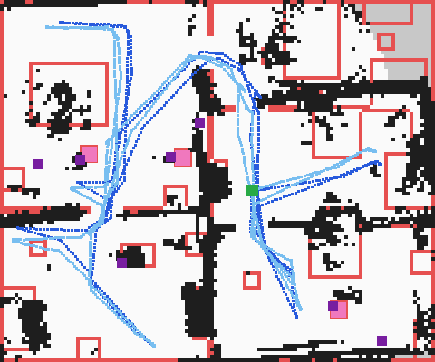

카메라로 만든 지도 (seed 3, 성공한 비행). 검정 = 지도에 그린 장애물(높이 0.3–1.8 m), 흰색 = 빈 곳, 회색 = 모르는 곳, 빨간 테두리 = 실제 장애물 중 지도에 안 그려진 부분, 분홍 = 실제 사람, 보라 = 찾은 사람, 진한 파랑·하늘색 = 실제·추정 궤적(둘이 벌어진 만큼이 위치 오차), 초록 = 출발점.

이전에 고친 것: 재계획 횟수 제한(30번)에 걸려 탐색 중 중단됨 → 4단계는 300번 / 책상·TV장 위로 날다 닿음 → 0.3–1.3 m에 막힘이 있으면 위아래 전체를 막음 / 탁자 위에서 갇혀 돌아오지 못함 → 지나온 길은 열어 둠, 비움 점수 −0.4 → −0.25.

**10/30 실기체 비행 뒤 더한 규칙** (자세한 것은 [AVOIDANCE.md](AVOIDANCE.md) 4.5·4.6, 실기체 기록은 [rooms/lab/README.md](rooms/lab/README.md) 8절):

- **지도 없이**: `real.launch.py`는 출발점이 가운데인 빈 지도(한 변 `area`, 기본 20 m)를 만들어 쓴다(`tools/make_room_map.py --open`). 11/02부터 `map:=`은 무시한다(실습실 지도를 쓰지 않음).
- **실기체는 탐색 하나** (11/03, 14:32 보관함 선반 앞 추락 뒤): `real.launch.py`는 인자 없이 탐색(0.2 m/s·120초)만 띄운다. 볼 자리는 가구·벽에 0.3 m 안으로 붙은 모르는 칸(선반 칸 안·가구 뒤 그늘)을 경계로 치지 않고, 둘레 0.45 m가 빈 자리에서 경계 앞 1.2 m 안의 가장 가까운 곳을 고른다(`frontier_viewpoint`의 `shadow`·`clearance`·`standoff`). 다음 경유점이 뒤쪽인데 둘레 0.4 m 안이 막혔으면 돌지 않고 자취로 후진한다(최근 2 m 안에 사람이 없을 때만). 기울기 70° 넘게 0.3초면 비상 정지, YOLO 결과가 와야 시작.
- **지나간 사람**: YOLO로 찾은 사람은 지름 약 1.2 m 장애물로 넣되, 그 자리를 카메라가 똑바로 봤는데 사람 상자도 없고 깊이로도 비어 있으면 1초쯤 뒤 길을 막지 않는다(목록에는 남는다).
- **기둥과 벽**: 정면 ToF에 걸린 것의 폭을 깊이 장면으로 재서, 기둥(≤ 1 m, 한쪽 빔)은 잰 폭만 막고 옆으로, 벽(≥ 1.5 m)은 그 폭을 다 '단단한 칸'으로 막아 방향을 바꾼다(11/03부터 장면 열 점에 맞춘 직선으로, ToF 원뿔 보정: 기수에 수직인 직선은 비스듬한 벽에서 복도를 막았다). 카메라가 못 보는 흰 벽은 ToF 점이 옆으로 이어질 때 벽으로 잇는다.
- **앞이 확실히 비면 빠르게**: 카메라 정면·정면 ToF·곧은 경로가 다 멀 때만 1.5→3 m에서 `speed`에서 `fast`(실기체 기본 speed의 2배, 최대 0.5 m/s)로. Gazebo는 `run_mission.sh --fast 0.5 --rc-limit 80`.
- **웹 화면**: YOLO 배지(초당 횟수·사람 수), YOLO가 돌면 탐지 영상 탭으로, 지도에 `/tt/obstacle_grid`와 찾은 사람(막는 사람·지나간 사람). `run_mission.sh --web`이면 Gazebo에서도 뜬다.
- **부드러운 정지** (11/02): 정면 ToF 0.45 m 안이 남은 경로를 막으면 비상 정지까지 기어가지 않고 멈춰 다시 계획한다. 상하 rc 무시 구간 보정(`vz_dead`)으로 비행 높이를 1.0 m에 맞춘다.
- **사람이 길을 막을 때** (11/02): 기다리지 않고 사람 둘레 여유 줄이기 → 키를 잰 낮은 사람이면 높이를 올려 위로 넘기(경로 높이 상한 `max_height`, 실기체는 `height_limit` − 0.15 = 1.35 m) → 부딪힐 위험이 높으면(0.6 m 안·사방을 둘러쌈) 그 자리 착륙, 낮으면 찾은 사람 둘레 여유를 몸 둘레 0.1 m만 남기고 탐색을 이어 간다(11/10 전에는 아예 뺐다 — Gazebo 사람 둘레에서 사람 옆을 0.25 m/s로 지나 −0.08 m). 찾은 사람 1 m 안에서는 0.12 m/s로 간다(11/10). 사람 키는 YOLO 상자 위 변으로 재서 `people.json`의 `top`에 남긴다. 경로 계획은 `max_height` 위로 짜지 않는다.
- **유리 앞·가까운 곳** (11/03, `autonomy/near.py`, 11/02 유리 사이 추락): 정면 ToF가 비어 있다가 0.6 m 안에서 처음 잡히면 유리로 보고 양옆 0.6 m를 막는다. 0.45 m 안에서는 제자리에서 돌지 않고 들어온 길로 물러난 뒤 천천히 돌며, 0.8 m 안 회전은 17°/s. 틈은 폭 30 cm·높이 20 cm 이상만(기체 20×20×10 cm).
- **이륙 전 기수 값 확인** (11/16, `tello_state.yaw_span`, 10:18 실기체 이륙 거절): 땅에서 Tello yaw 값이 흐르는 동안(최근 10초에 2° 이상)은
  시작을 받지 않고 이유를 알린다(`start_blocked`, 웹 '기수 값' 게이지). 지난 이륙 요청 52번에서 받아들인 29번은 직전 10초에 한 번도 안
  바뀌었고 거절한 23번은 모두 바뀌고 있었다. Tello가 바로 거절하면 저절로 다시 보내지 않고 시작 대기로 돌아간다(`takeoff_refused`).
- **가운데로 다니기** (11/14): 볼 자리는 후보 중 둘레 1 m가 빈 곳을 먼저 고르고(`frontier_viewpoint`의 `room_prefer`, 전에는 가는 길에서
  가장 가까운 후보라 둘러본 자리의 84%가 벽 0.7 m 안이었다), 경로 지름길은 비용이 더 크면 쓰지 않는다(`planner.shortcut`의 `by_cost` —
  벽 옆에서 출발하면 가운데로 돌아간 길을 벽을 따라가는 직선으로 되돌리던 것). 선호 거리 `PREFER` 0.5 m는 늘려도 효과가 없어 그대로.
  자세한 숫자는 [AVOIDANCE.md](AVOIDANCE.md) '가운데로 다니기'.
- **옆 겨눠 보기** (11/14, `near.side_near`, 11/13 17:44 실기체): 경로를 따라 나아갈 때 지금 기수로 찍은 깊이 장면이 온 만큼만 나아가고(6° 안
  그대로, 12° 넘게 어긋나면 서서 돎), 양옆(정면 ToF 원뿔 밖)이 가깝게 읽히는데 지도가 모르는 쪽이면 나아가기 전에 그쪽으로 기수를 돌려
  정면 ToF로 잰다. 단안 깊이는 1.3 m 안의 흰 면을 거리와 상관없이 0.6–0.7 m로 읽어 카메라만으로는 가까운 면을 못 가린다. [AVOIDANCE.md](AVOIDANCE.md) 4.8.
- **닿으면 떼어 내기** (11/13, `autonomy/contact.py`, 13:51 실기체): 어느 비행 단계든 수평 가속 0.3 g·0.12 g 넘게 0.6초·기울기 15°·돌라는데
  1.2초 넘게 안 돎(물러나는 중 기수가 저절로 20° 돎도)·가라는데 안 감(11/14, 보낸 명령을 모은 거리에 비해 위치가 거의 안 옮겨짐 — 2–3초는
  반대쪽 반력 60 mg과 함께, 4초는 그것만)이면 닿은 쪽에 장애물을 세우고 반대쪽으로 0.3 m 떨어질 때까지(최대 2초) 밀어(`UNSTICK`) 떼어 낸 뒤 1.5초 머문다(`HOLD`).
  카메라 지도가 모르는 면(유리·흰 벽)에 닿았으면 양옆 0.6 m를 막는다.
  입력 0만 보내면 Tello가 제자리를 지키려 닿은 쪽으로 계속 밀었다. 6초 안에 이어진 닿음은 한 사건으로 세어 더 멀리 밀고, 세 번 떼어 내도 또 닿거나 같은 곳에서 30초 안에 사건이 세 번이면 그 자리에 내린다. 자세한 것은 [AVOIDANCE.md](AVOIDANCE.md) 4.8.
  **후진은 막힌 주머니에서만**(11/03 저녁 2, 16:12 복기): 둘레 0.25 m 안이 막혀 돌 자리가 없고 정면 좌·우 1 m 안이 모두 막혔을 때만 들어온 자취를 따라 기체 뒤쪽으로 곧게 후진(`EXIT`, 0.18 m/s, 옆 0.05까지), 돌 자리가 생기면 바로 끝내고 돌아서 정면으로(0.2–1.5 m). 경로 추종의 옆 속도도 0.05 m/s까지. 경로 계획은 경계에서 0.5 m까지 멀수록 싸게(복도 가운데), 계획용 지도 부풀리기는 수평 원반+위아래 한 칸(134 → 17 ms). Gazebo 미확인.
- **가구 위로 넘기** (11/03, 수직 공간 쓰기): 카메라 지도의 기둥 막기를 전체 대신 '본 꼭대기 + 0.5 m(최소 1.2 m)'까지로 줄여, 카메라가 빈 것으로 본 그 위로 올라가 넘는다. 높이 상한은 천장 기준(`ceiling` 2.5 → 드라이버 2.0, 경로 1.85 m; `mission.launch height_limit`). 위치 추정은 가구 위에서 짧아진 하방 ToF를 Tello `h`가 같이 내려가지 않는 한 믿지 않는다. 하방 ToF가 0.35 m보다 짧으면 멈추고 오르며 그 자리를 막는다(밑 감시). 정면 ToF·장면·물러나기는 지금 높이 기준.
- **배터리** (11/02): 이륙 기준 없음(10% 이하만 거절), 비행 중 10% 이하면 그 자리 착륙. 그 밖에는 배터리로 출력을 줄이거나 내리지 않는다.
- **같은 곳 다시 안 가기**: 볼 자리는 가던 방향을 유지하고(뒤쪽 경계는 절반) 둘러본 자리 1.0 m 안은 다시 고르지 않으며, 둘러보기는 안 본 쪽이 많이 남았을 때만, 지금 보는 쪽은 돌지 않는다. 기록 페이지에 다시 간 칸·볼 자리 닿음·새로 본 넓이/m 칩.
- **동선 고르기** (11/04, 10:17 라운지 구석 비행 복기 — 못 가는 볼 자리 두 곳에 탐색의 57%): 볼 자리 하나에 재계획 6번 초과 또는 움직이는 동안 12초
  남은 경로가 안 줄면 포기하고 둘레 1.5 m를 빼고(`explore.ViewpointBudget`), 점수는 그 자리에서 3 m 안에 새로 보일 넓이 ÷ (1 + 거리/6 m)(0.3 m² 미만은
  안 감), 정면 ToF가 잰 면 너머를 깊이가 칠했으면 그 빈 칸을 지운다(`shape.see_through`, `CameraMap.forget_behind`). 창 유리는 ToF도 통과해 마지막
  것이 못 막는다. 결과는 [AVOIDANCE.md](AVOIDANCE.md) 4.7 '동선 고르기'.
- **깊이 배율·판단 속도·남은 시간** (11/04 12:57 복기): 실기체 깊이 배율은 바닥 대신 정면 ToF로 맞춘다(`depth_scale_mode` tof,
  `perception.depth.TofDepthScale` — 바닥 배율이 1.30에 붙어 깊이가 30% 멀었다. 시뮬레이션은 기본 floor, `run_mission.sh --tof-scale`로 실기체와
  같게). 11/11부터 그 배율은 최근 300초 중앙값을 표본이 적을수록 1.0 쪽으로 당겨 0.8–1.25 안에서 쓴다 — 60초 중앙값(0.7–1.4)은 실기체
  한 비행 안에서 0.70 ↔ 1.29로 튀었고, 먼 거리(1.2–3.5 m)에서는 1.0 고정보다 나빴다(가방 6개 재연, [AVOIDANCE.md](AVOIDANCE.md) 2절).
  그 배율이 1보다 작으면 깊이 지도의 바닥 문턱을 그만큼 올린다(`CameraMap.integrate_depth(scale=…)`). 실기체 깊이 추정·YOLO는 초당 10번(`depth_rate`·`yolo_rate`, 전 5번 — 비행 중 GPU 사용률 20%였다), 계획용 지도는 0.5초마다. 지나간 사람
  판정은 5번 + 1초. 볼 자리는 남은 탐색 시간 × 속도 × 0.7 안에서만 고른다.
- **닫힌 공간** (11/04 저녁, 사용자 제안): 30×30 cm 넘는 틈으로 이어진 못 본 곳만 경계로 치고(`frontier_viewpoint(passage=0.3, reach_frontier=True)`,
  0.6 m보다 좁은 문·통로 입구도 이제 경계), 작은 구멍·닫힌 창 너머는 치지 않는다. 창턱(0.5–1.2 m 막힘, 위는 빔, 0.2 m 안에 1.9–2.3 m 위 벽)은
  계획 지도에서 위아래 전체를 막는다(`CameraMap.window_sills`, `close_windows`; 지나온 자리는 뺌) — 창 위 벽이 지도에 잡혀야 하며, Gazebo 창
  월드에서는 단안 깊이가 위 벽을 못 잡아 한 번 창을 지났다. 가구 위로 넘기는 그대로. 지금 공간 5 m 안에
  통로가 없으면 ② 창에 '닫힌 공간 … 통로로 갑니다'를 남긴다(`frontier_census`). 결과는 [AVOIDANCE.md](AVOIDANCE.md) 4.7 '닫힌 공간'.
- **입력·명령 믿을 수 있게** (11/04 밤, 외부 리뷰): rc는 ToF 조회 응답을 기다리지 않고 바로 나간다(`TelloLink.rc`), 오래된 위치(0.5초)·
  전방 ToF(1초)로는 움직이지 않고 2·3초면 내린다(`autonomy/fresh.py`), 위치 오차 '모름'을 0으로 바꾸지 않는다, A*는 모서리를 자르지 않고
  돌려줄 경로의 모든 선분을 다시 검사한다, NaN 깊이는 버린다, 지나온 칸에 ToF가 다시 막힘을 찍으면 막는다. [AVOIDANCE.md](AVOIDANCE.md) 4.10.
- **문 지나기** (11/05, `autonomy/doorway.py`, 10:51·13:04 실기체 복기): 경로가 폭 약 1.2 m 안의 틈을 지나면 문으로 보고(경로 따라 가장 좁은 곳에서
  가로선을 돌려 양옆 문틀 찾기, 지도 폭 0.5–1.6 m), 문 앞 0.8 m에서 멈춰 정면을 맞추고 다시 잰 뒤 정면 ToF가 문 너머까지 비면 0.15 m/s로
  가운데 선을 따라 곧게 지난다(`DOOR`). 빠져나갈 자리 앞이 막히면 멈추고 물러난다. 문 너머 볼 자리는 '좁은 길' 빨리 포기를 쓰지 않고 포기해도
  둘레 0.6 m만 빼며, 끝나기 전에 한 번 더 본다. 정면 ToF가 면을 잰 자리 0.3 m 안은 '지나온 칸'에서 빼고(`CameraMap.unfly` — 위치가 틀어져
  지나온 칸이 문짝·칸막이를 덮어 같은 자리로 되풀이 다가갔다), 물러나기는 옆 0으로 곧게. [AVOIDANCE.md](AVOIDANCE.md) 4.11.
  제자리에서 돌기 전에 아직 앞으로 미끄러지고 있으면(0.06 m/s 넘게) 뒤로 짧게 밀어 멈춘 뒤 돈다(`near.turn_brake`, 4.8 '돌기 전 제동').
  돌면서 가기(`arc_speed` 0.12)는 의도한 전진이라 그대로.
- **가짜 바닥·비행 높이로 돌아오기·그 자리 착륙** (11/11 09:32 실기체 복기): 단안 깊이가 바닥을 30–40% 가깝게 읽어, 가구를 넘느라 1.4 m로 오르면
  0.45–0.55 m에 가짜 바닥이 깔려 1.0 m로 못 내려오고 1.35–1.45 m의 구불구불한 틈으로 날았다(복도 지그재그). 깊이 끝점은 카메라 높이의 0.45배(0.6 m까지)
  아래면 바닥으로 보고(`CameraMapParams.floor_frac`), 계획은 비행 높이 한 층을 먼저 찾고 넘을 곳 앞뒤로만 오르내리며(`planner.plan`·`_level`·`_hold_height`),
  길 없음은 3D 덩어리 검사로 1–8 ms에 끝낸다(`_reachable`). 탐색이 끝나면 돌아가지 않고 그 자리에 내리는 `return_home:=false`를 더했다
  ([AVOIDANCE.md](AVOIDANCE.md) 4.9 '가짜 바닥'). 같은 날 Gazebo 회귀에서 찾은 넷: 정면 ToF가 찍은 띠는 일부가 지워져도 그 위로 넘지 않고
  (`CameraMap.planning_map`, 4.9 '계획 지도의 기둥'), 볼 자리가 방금 지나온 문 안이었으면 되돌아가지 않고 바로 둘러보며(`Doorway.covers`, 4.11),
  후진할 자취는 가장 최근 다리에서만 자르고 자취가 기수 쪽이면 후진하지 않고(`near.trail_trim`·`off_tail`, 4.8 '후진'), 경로가 목적지 0.25 m 넘게
  앞에서 끝나면 맞추러 가지 않고 그 자리에 내린다(`land_at_goal`, 4.8 '돌아오기 마무리'). 이어서 둘 더: 앞뒤로 같은 폭이 이어지는
  넓은(1.05 m~) 틈은 복도로 보고 문 지나기를 쓰지 않고(`doorway.is_corridor`), 돌아갈 길이 지도에서 닫히면 들어올 때 지난 틈을 같은
  문 지나기로 되나간다(`reopen_door`·`doorway.open_axis`·`trail_gap`, 4.11). 문 0.75 m 안에서 다시 계획해도 문을 놓치지 않는다
  (`find_doorway`의 `ahead`: 출발점에서 이어지는 좁은 구간이라도 가장 좁은 곳이 0.4 m 넘게 앞이면 문).
- **돌아오기 마무리·길 없음 빨리·문 앞 기다리기·밑 지도 높이** (11/09 저녁 실기체 복기): 돌아오는 중 출발점까지 길이 없으면 1.5 m 안 빈 자리로 다시 겨누고,
  출발점 2 m 안에서 30초 정체·120초 초과·길 없음이면 그 자리에 내린다(11/06 14:35 1 m 앞 ABORT, 17:07 150초 헤맴). A* 전 평면 연결 검사로
  길 없음을 몇 ms에 끝내고, 길 계획이 오래 걸려 밀린 위치 경고는 그렇게 말한다. 사람이 오가 문 가운데가 흔들리면 6초까지 기다렸다 다시 잰다(13:05).
  높이: 하방 ToF는 바로 밑 물건까지 거리라, 깊이로 쌓은 카메라 지도가 아는 '기체 밑 가구 꼭대기'를 위치 추정에 알려 높이 = ToF + 꼭대기로
  잡는다(`/tt/under_map`, `CameraMap.top_below`, `EstimatorParams.under_*`; 지도에 없으면 Tello h 규칙). 단안 깊이로 바닥 높이를 직접 재는 것은
  ToF와 0.2 m 안에 든 영상이 2–18%뿐이라 쓰지 않는다 ([AVOIDANCE.md](AVOIDANCE.md) 4.8·4.9).
- **뒤 확인·둘러본 자리 기억** (11/09 실기체 복기): 물러나기 전에 뒤 0.55 m·옆 ±0.15 m가 카메라로 본 빈 곳이거나 지나온 곳인지 보고,
  아니면 물러나지 않고 천천히 돈다(`near.rear_unknown`, 13:03 이륙 직후 본 적 없는 뒤로 후진하다 추락; [AVOIDANCE.md](AVOIDANCE.md) 4.8 '뒤 확인').
  **들어온 길 쪽으로만**(11/16, `Mission.retreat_check`): 뒤 확인을 통과해도 기체 뒤쪽이 들어온 자취에서 45° 넘게 벗어나 있으면(돌고 난 뒤)
  물러나지 않고 천천히 돈다 — 뒤 띠가 실제로 지나온 칸(`CameraMap.flown_at`)이거나, 돌 자리가 없거나, 정면이 0.25 m 안일 때만 전처럼 물러난다.
  11/16 Gazebo 방 두 개에서 문틀 사이에서 둘러보다 지도에 없던 반대편 문틀 쪽으로 물러나 0.04 m까지 붙었다. 지난 실기체 물러나기 44번 중
  22번이 벗어난 쪽이었고 그 가운데 7번에 닿은 흔적이 있었다(들어온 길 쪽 22번에서는 2번). 시험 `tests/test_retreat.py`.
  Gazebo 9판(11/17): 고친 규칙 7판 닿음 0번·최소 간격 0.18–0.34 m, 고치기 전 규칙으로 돌린 방 두 개 판은 문틀 0.03 m까지 다시 붙음
  ([AVOIDANCE.md](AVOIDANCE.md) 4.8 '들어온 길 쪽으로만 물러나기'). 실기체 전이다.
  둘러보기를 마친 자리는 이륙 직후 출발점까지 기억해 1 m 안을 다시 볼 자리로 고르지 않는다(13:05 출발점을 두 번 둘러봄).
- **운용자가 찍은 자리** (11/11, `autonomy/goto.py`, 사용자 요청: 자율비행 중에 경로에 참여하기): 탐색 중에 웹 지도에서 찍은 곳
  (`/tt/mission_cmd goto <x> <y>`)을 다음 볼 자리로 삼는다. 경로를 따라가는 중·다시 계획할 때는 바로, 둘러보기·물러나기·후진·문 지나기는
  마친 뒤에 잡는다(`goto_take` → `choose_viewpoint`의 `goto_choose`). 찍은 칸이 계획 지도에서 막혔거나 못 본 곳이면, 또는 비었어도 거기까지
  길이 없으면(`goto_fallback`), 줄인 여유의 계획 지도에서 드론과 이어진 빈 칸 가운데 찍은 곳에 가장 가까운(둘레 0.2 m가 빈 칸 먼저) 자리로 옮기고
  도착해서 찍은 쪽부터 본다(`goto_spot`·`goto.snap`). 옮긴 자리가 찍은 곳 1.5 m 안이거나 지금 자리보다 0.5 m 넘게 가까울 때만이다 — 멀리 찍으면
  그쪽 가장자리까지 가고, 이미 가장 가까이 와 있으면 받지 않는다. 가는 길·회피·문 지나기·포기 기준은 평소 볼 자리와 같고, 도착하면 둘러본 뒤
  자율 탐색을 잇는다. 끝내 길이 없으면 알리고 하던 탐색을 잇되 '못 간 자리'(20곳이면 탐색 끝)에는 넣지 않는다. 막힌 경계를 다시 보러 가던 길에
  끼어들면 그 경계를 다시 고를 수 있게 되돌린다. 더 볼 곳이 없어 돌아가는 중이라도 탐색 시간이 남았으면 받는다. 받았는지·가는 중인지·못 가는
  이유는 `/tt/operator_goal`로 웹 화면에 알린다. 단위 시험(`tests/test_goto.py`), 웹 화면(가짜 비행 노드), Gazebo 5판(실기체 설정: 닿음·비상 정지
  0번, 찍어 보낸 20번 중 도착 10·취소 2·시간 뒤 거절 4·못 감 4, 안 찍은 대조 판과 탐색 넓이 같음)으로 확인했고 실기체로는 아직 날려 보지 않았다
  ([AVOIDANCE.md](AVOIDANCE.md) 5절 '운용자가 찍은 자리'). 11/12 10:07 첫 실기체에서는 찍은 자리가 거절됐다 — 카메라 지도로는 비었는데 찾은 사람·
  '가까운 사람' 상자의 둘레 여유가 사이 입구를 닫았다. 그래서 찍은 곳 1.5 m 안까지 갈 자리가 없으면 자율 탐색과 같은 순서로 둘레 여유를 한 단계씩
  줄여 이어지는 첫 단계에서 멈춘다(`goto_relax`: 찾은 장애물 0.2 m → 카메라로만 본 장애물 빼기 → 사람 둘레 0.15 m → 몇 번만 잡힌 사람 빼기 →
  위험이 낮으면 몸 둘레만; 안 이어지면 되돌림, 줄인 사람 여유는 2 m 벗어나면 되돌림). 시험, 그 비행 기록 재연, Gazebo 3판(사람이 입구·복도를 막은
  월드: 여유를 줄여 다가가되 사람이 그대로 서 있으면 지나지 않고 그만둠, 닿음 0번·사람과 0.47 m 넘게)으로 확인했고 실기체 전이다.
- **탐색 시간이 끝난 뒤의 찍은 자리·지금 하는 일과 이유** (11/16 15:33 실기체): 탐색 시간(120초)이 다 돼 돌아가던 중 찍은 세 자리(모두 본 빈 칸)가
  `탐색 시간이 다 됐습니다`로 거절됐고, 웹 화면에는 단계 이름만 나와 운용자가 왜 돌아가 내렸는지 몰랐다. 그래서 ① 탐색 시간이 다 된 뒤에도
  찍은 자리를 받는다 — 돌아가기를 멈추고 다녀온 뒤 `choose_viewpoint`가 다시 돌아가기를 시작한다(`goto_refusal`·`goto_after`. 이륙·출발점 위 한 바퀴·
  착륙 중에는 여전히 받지 않고, 배터리·온도 자동 착륙은 그대로) ② 비행 노드가 `/tt/mission_note`로 탐색 경과·한도, 돌아가는 이유, 내리거나 중단한
  이유를 낸다(`publish_note`). 내리는 이유는 자리마다 따로 적지 않고, 그 직전에 남긴 로그를 그대로 쓴다(`Said`가 마지막 말을 기억, `end_reason`;
  평소 끝인 출발점 착륙만 `land_at_goal`이 `탐색 시간(120초)이 다 돼 출발점으로 돌아와 내립니다`로 정한다) ③ 웹 화면은 그것을 맨 위 띠에 보이고,
  찍은 자리에 대한 답은 [여기로 보내기] 옆에 20초 보인다. 시험 `tests/test_goto.py`·`tests/test_mission_note.py`, 웹 화면은 가짜 상태값으로 확인.
  Gazebo 4판(실기체 설정 + 웹 화면 서버, 시험용 운용자가 웹 API로 보냄): 탐색 시간이 끝난 뒤 보낸 6번을 모두 받아 다녀온 뒤 출발점에 내림,
  내리는 중 3번은 거절, 닿음·비상 정지 0번. 방 두 개 판의 최소 간격 0.04 m는 찍기 전 자율 탐색 중의 일이다(문 가운데를 0.5 m 앞으로 잡아
  문틀 사이에서 둘러보다 반대편 문틀 쪽으로 물러남 — 기존 동작, 아직 안 고침). 실기체 전이다.

## ROS 2 토픽

| 토픽 | 형식 | 용도 |
| --- | --- | --- |
| `/tt/camera/image_delayed` | `sensor_msgs/Image` | **인식·제어 코드는 이것을 쓴다** (175 ms 지연) |
| `/tt/camera/image_raw` | `sensor_msgs/Image` | 지연 없는 원본 (디버깅용) |
| `/tt/camera/camera_info` | `sensor_msgs/CameraInfo` | 카메라 내부 파라미터 |
| `/tt/tof_front`, `/tt/tof_front_up`, `/tt/tof_front_down` | `sensor_msgs/LaserScan` | 전방 ToF 가운데·위·아래 줄. 세 토픽 `ranges` 전체의 최솟값이 실제 센서 측정값, 1.2 m 초과는 inf |
| `/tt/tof_down` | `sensor_msgs/LaserScan` | 바닥까지 높이 |
| `/tt/imu` | `sensor_msgs/Imu` | IMU |
| `/tt/cmd_vel` | `geometry_msgs/Twist` | 비행 노드의 속도 명령 (기체 기준 x 앞, y 왼쪽, z 위, angular.z 요). 기본은 Tello 드라이버가 받아 rc로 바꾼다 |
| `/tt/flight_cmd` | `std_msgs/String` | 이륙·착륙·비상 정지 요청 (`takeoff`, `land`, `emergency`) → Tello 드라이버 |
| `/tt/flight_status` | `std_msgs/String` | Tello 드라이버 상태 JSON (`connected`, `flying`, `busy`, `can_takeoff`, `last_rc` …) |
| `/tt/sim/cmd_vel` | `geometry_msgs/Twist` | (시뮬레이션 전용) gz_tello.py가 rc를 바꾼 기체 속도 → Gazebo. `--direct`면 쓰지 않고 `/tt/cmd_vel`이 Gazebo로 간다 |
| `/tt/state` | `std_msgs/String` | Tello 상태 문자열 JSON `{"stamp", "raw"}` (Tello 드라이버. `--direct`면 sim_tello_state.py) |
| `/tt/depth` | `sensor_msgs/Image` 32FC1 | 카메라 영상으로 추정한 깊이 (m, 240×180, stamp는 촬영 시각). 4단계 지도용 |
| `/tt/camera/depth_gt` | `sensor_msgs/Image` 32FC1 | (평가 전용) 정답 깊이 카메라. 비행 코드는 쓰지 않는다 (TT에는 없는 센서, 테스트로 확인) |
| `/tt/pose_est` | `nav_msgs/Odometry` | **비행 코드가 쓰는 추정 위치.** 공분산 대각에 위치 불확실성 σ² |
| `/tt/relocalize` | `std_msgs/String` | 위치 다시 잡기 요청 JSON `{"xy", "yaw"}` (비행 노드 → 위치 추정 노드: 후보를 그만큼 흩는다) |
| `/tt/odometry_gt` | `nav_msgs/Odometry` | 정답 위치. 평가용(truth_log.csv)이며 비행 코드는 쓰지 않는다 (`--gt-pose` 비교 때만) |
| `/tt/path` | `nav_msgs/Path` | 자율비행이 계획한 경로 (RViz에서 확인) |
| `/tt/mission_state` | `std_msgs/String` | 자율비행 단계 (WAIT_POSE, READY, TAKEOFF, PLAN, FOLLOW, REPLAN, BACKOFF, HOLD, EXIT, LOOK, RELOC, HOMESPIN, LAND, DONE, ABORT). EXIT는 들어온 자취로 되짚기·후진 바뀔 때와 1초마다 |
| `/tt/mission_cmd` | `std_msgs/String` | 비행 노드에 `start`(READY에서 출발, `wait_start:=true`일 때) · `land`(그 자리에 착륙) · `goto <x> <y>`(탐색 중: 운용자가 웹 지도에서 찍은 자리를 다음 볼 자리로) · `goto cancel`. 자율비행 웹 화면이 보낸다 |
| `/tt/operator_goal` | `std_msgs/String` | 운용자가 찍은 자리의 상태 JSON `{"seq", "t", "state"(none·pending·going·arrived), "text", "warn", "click", "goal"}` (비행 노드 → 웹 화면: 기록에 적고 지도에 그리며, 마지막 답은 버튼 옆에 20초 보인다. 바뀔 때, 가는 중이면 1초마다) |
| `/tt/mission_note` | `std_msgs/String` | 지금 하는 일과 이유 JSON `{"t", "state", "search": {"elapsed", "limit"}, "returning", "why_return", "return_home", "why_end"}` (비행 노드 → 웹 화면 맨 위 띠: 남은 탐색 시간·돌아가는 이유·내린 이유. 단계가 바뀔 때와 1초마다, 11/16) |
| `/tt/detections` | `std_msgs/String` | YOLO 탐지 결과 JSON |
| `/tt/detections/image` | `sensor_msgs/Image` | 탐지 상자를 그린 영상 |
| `/tt/person_events` | `std_msgs/String` | 팀 공통 사람 탐지 계약 `person-detection-event/1.0` JSON (`modules/perception/inference`, 사람 윤곽·마스크 안 깊이) |
| `/tt/obstacle_grid` | `nav_msgs/OccupancyGrid` | (4단계) 카메라 지도의 비행 높이 단면: 100 막힘, 50 의심(경로는 피함), 0 본 빈 곳, −1 모름. 자율비행 웹 화면이 그린다 |

## 단계와 출력 파일

같은 seed는 단계를 바꿔도 **같은 건물**을 만들고, 단계는 드론에게 주는 정보만 바꿉니다. 그래서 단계별 결과를 같은 맵에서 비교할 수 있습니다.

| 단계 | 상황 | known_map.json | 사람 |
| --- | --- | --- | --- |
| 1 | 지도 있음, 목적지 명확 | 벽 + 모든 가구·물건 + 목적지 | 없음 |
| 2 | 지도에 없는 물건 추가 | 벽 + 가구 + 목적지. 새로 놓인 물건(상자 더미·라바콘·카트·의자, `--blockers`로 놓은 상자 더미·사람)은 빠짐 | 없음 (`--blockers`의 사람은 장애물) |
| 3 | 목적지 없음, 사람 찾기 | 벽 + 가구, 목적지 없음 | 3명 |
| 4 | 지도 없음, 사람 찾기 | 영역 경계와 출발점만 | 3명 |

| 파일 | 내용 | 누가 쓰나 |
| --- | --- | --- |
| `world.sdf` | Gazebo가 띄우는 실제 맵 전체 | Gazebo |
| `known_map.json` | 드론에게 미리 주는 지도 | 자율비행 코드 |
| `ground_truth.json` | 방 종류, 숨긴 물건·사람 위치를 포함한 정답 | **평가 코드만** |
| `preview.png` | 위에서 본 그림 | 사람 확인용 |
| `textures/` | 바닥·벽·그림·화이트보드·상자 텍스처 | Gazebo |
| `flight_log.csv`, `discovered.json` | 비행 기록, 비행 중 찾은 장애물 (비행 뒤 생김) | 평가 코드 |
| `flight.png` | 위에서 본 궤적·찾은 장애물 (`eval_flight.py`가 그림) | 사람 확인용 |

미리보기 색: 바닥 색 = 방 종류(갈색 마루, 흰 타일, 파란 카펫, 회색 콘크리트), 검정 = 벽, 회색 = 지도에 있는 가구, 빨강 = 지도에 없는 물건, 파랑 = 사람, 초록 = 출발점, 주황 = 목적지.

## 생성 규칙

| 방 | 바닥 | 가구 | 벽 장식 |
| --- | --- | --- | --- |
| 사무실 | 타일 | 책상(모니터·의자) 1–3, 책장, 서랍장, 화분 | 화이트보드, 그림 |
| 거실 | 마루 | 소파, TV장, 책장, 화분 1–2, 가운데 탁자 | 그림 2 |
| 침실 | 마루 | 침대, 옷장, 책상, 화분 | 그림 |
| 회의실 | 카펫 | 회의 탁자(의자 포함), 서랍장, 화분 1–2 | 화이트보드, 그림 |
| 창고 | 콘크리트 | 선반(상자 포함) 2–3, 상자 더미 | 없음 |

- 방은 한 변 3 m 이상이고, 넓이에 따라 종류를 정하되 아직 안 나온 종류를 먼저 고릅니다.
- 문은 폭 1 m, 높이 2.1 m이고 문틀이 있습니다. 문 위 벽(높이 2.1–2.5 m)은 `known_map.json`의 `lintels`에 따로 들어 있습니다.
- 모든 벽에 걸레받이가 있고, 바깥벽에는 창문을 냅니다. 장식에는 충돌체가 없습니다.
- 가구는 대부분 벽에 등을 붙여 놓고, 문 앞 1 m는 비웁니다. 충돌체는 가구마다 바닥 면적 상자 하나입니다.
- 숨긴 물건과 사람까지 모두 놓아도 모든 방과 목적지, 사람 근처로 갈 수 있음을 드론 반지름 0.2 m 기준으로 확인합니다.
- 벽은 실제 실내처럼 거의 단색이라, 시각 SLAM의 특징점은 주로 가구·문틀·창문·그림·바닥 무늬에서 나옵니다.

주요 옵션: `--width`, `--depth`, `--humans`, `--clutter`(지도에 없는 물건 수), `--blockers`(드론이 받은 지도로 짤 경로 위에 놓는 지도에 없는 물건 수), `--human-model simple`(인터넷 없이 원기둥 모양 사람).

## 알려진 한계와 다음 할 일

- **긴 비행에서 위치 추정이 틀린 채 자신만만해질 수 있습니다.** 3단계(4–6분 비행)에서 추정이 0.3–0.5 m 틀어졌는데 σ는 0.1 m 안팎인 때가 있었습니다. 잡음 값을 키워 봐도 나아지지 않았습니다(`tools/replay_pose.py --inputs`로 기록된 비행 18개 비교). 길이 막히면 제자리에서 천천히 돌며 위치를 다시 잡는 동작(RELOC)을 넣었지만, 마지막 시험에서는 실행될 일이 없어 실제 비행에서의 효과는 아직 확인하지 못했습니다. 1.1 m 안에 벽이 두 방향 넘게 있어야 도움이 되므로, 넓은 곳까지 다루려면 카메라로 보정하는 일(Jira 209)이 다음입니다.
- **4단계(지도 없음)의 위치는 카메라 지도로 바로잡아도 0.2–0.5 m 틀어질 때가 있습니다.** 속도 적분만이면 3–5분 탐색에서 0.5–1.0 m까지 틀어졌고, `--localize`로 0.24–0.50 m까지 줄였습니다(6개 맵 중 4번 성공). 맞추기 한 번이 단안 깊이 오차로 약 0.13 m 흔들려 조금씩만 고칠 수 있습니다. 위치 오차가 0.16 m를 넘으면 지도 여유(0.25 m) 안에서 장애물에 닿을 수 있습니다. 깊이 추정에 기대지 않는 시각 주행 거리계(특징점 VO + IMU)나 VL53L5CX(8×8 ToF)로 맞추기를 보태는 것이 다음 후보입니다(Jira 209). 실기체에서는 `pose_lag`(추정 위치 지연)도 다시 재야 합니다.
- **단안 깊이는 물체마다 20% 안팎 틀립니다.** 바닥으로 장면 배율 맞추기, 1 m 안 추정·깊이 경계 화소는 막힘으로 안 찍기로 헛 장애물을 줄였고, 남은 헛 장애물이 길을 막으면 가까이 가서 다시 보며 지웁니다. 그래도 '비어 있다고 잘못 본 곳'이 10–20% 남습니다(대부분 실제 장애물 가장자리 한두 칸).
- **ToF는 옆을 못 봅니다.** 지도에 없는 물체가 ToF 시야(±12.5°) 바로 바깥으로 지나가면 끝까지 못 보고 스칩니다(2단계 seed 7, 정답 위치로 날아도 0.06 m). 시야 45°인 VL53L5CX를 달거나, 이동 중 기수를 좌우로 흔들어 시야를 넓히는 방법이 있습니다.
- **비행 높이 1.0 m는 의자 등받이(0.96 m)와 너무 가깝습니다.** 지도에 없는 의자 위를 1.5 cm 차로 지난 일이 있었습니다(2단계 seed 4). 실기체에서는 비행 높이를 1.2 m로 올리는 것을 권합니다(`known_map.json`의 `flight_height`와 `nodes/pose_node.py`의 `flight_height` 파라미터를 같이 바꿉니다. 맵 생성기는 `worldgen/layout.py`의 `LayoutParams.flight_height`).
- **위치 추정은 넓은 공간에서 약합니다.** 전방 ToF는 1.2 m 안만 보므로, 벽이 멀리 있는 넓은 방에서는 지도 보정이 거의 안 되고 속도 배율 오차가 그대로 쌓입니다(1 m당 수 cm). 카메라로 보정하는 일(Jira 209)과 VL53L5CX(4 m)가 이를 줄일 수 있습니다.
- **Tello 상태값 규약은 가정입니다.** yaw 부호, 속도 기준(기체/이륙 방향), 속도 배율 오차는 실기체로 확인해야 합니다('정답 위치 없이 날기' 절의 확인 순서).
- **ToF 한 점은 방향을 모릅니다.** 같은 물체를 다른 각도에서 다시 재면 0.5–0.7 m 옆에 기둥이 하나 더 생겨, 재계획이 늘고 길이 좁아 보입니다(비행 중 생성 시험에서 자주 보임). VL53L5CX(8×8)를 달면 방향을 알 수 있어 크게 줄어들 부분입니다.
- **찾은 장애물의 크기는 어림입니다.** 단일점 ToF는 앞면까지 거리만 주므로 깊이 0.6 m를 가정하고, 옆에서 지나가는 물체는 보지 못합니다. 실제보다 큰 물체 옆을 지날 때 간격이 줄어들 수 있습니다.
- **YOLO가 지도에 있는 큰 가구를 엉뚱한 자리에 잡을 수 있습니다.** 상자 아래 변이 가구 다리나 앞면이 아니라 다른 곳에 걸리면 위치가 어긋나 '지도에 없는 장애물'로 들어갑니다(seed 3의 침대). 지금은 길이 막힐 때만 빼므로, 길을 돌게 만드는 오탐은 그대로 남습니다.
- **YOLO 위치 추정은 카메라가 수평이라고 가정합니다.** 시뮬레이션 드론은 기울지 않지만 실기체는 앞으로 갈 때 앞으로 기울어 거리가 짧게 나옵니다. 실기체에서는 IMU 자세로 보정해야 합니다.
- **시뮬레이션 ToF는 광선 21개로 원뿔을 흉내 냅니다.** 카트 손잡이처럼 3 cm짜리 가는 물체는 광선 사이로 빠질 수 있습니다. 실제 센서는 원뿔 전체를 보지만, 반사율·각도에 따라 못 잡는 물체가 있어 실측이 필요합니다.
- **ToF 시야 25°, 깊이 0.6 m, 여유 0.3 m 같은 값은 가정입니다.** 실기체 ToF 사양을 확인해 `nodes/mission_node.py`와 `models/tt_drone/model.sdf`를 함께 바꾸세요.
- **운동학 모델이라 실제 비행 특성이 없습니다.** 가속 지연, 흔들림, 배터리 소모가 없으니 속도 명령에 1차 지연을 넣는 것이 다음 개선 후보입니다.
- **천장이 없습니다.** 위에서 내려다보기 쉽게 뺐습니다. 하방이 아닌 상방 센서를 쓸 일이 생기면 추가해야 합니다.
- **가구 충돌체는 바닥 면적 상자입니다.** 책상 밑이나 탁자 밑으로는 지나갈 수 없습니다.
- **유리창이 ToF에 막힌 면으로 잡힙니다.** 실제 ToF는 유리를 통과하거나 반사될 수 있습니다.
- **Fuel 사람(actor)에는 충돌체가 없어** 3·4단계 사람은 드론이 통과합니다(탐지 대상). `--blockers`로 길에 세운 사람은 같은 자리에 충돌 상자를 따로 둡니다. 처음 실행할 때 메시를 인터넷에서 내려받습니다.
- **Tello 드라이버는 아직 실기체로 날려 보지 않았습니다.** 시뮬레이션은 같은 드라이버·UDP 명령으로 날지만, rc → 속도 배율·지연,
  이륙·착륙 시간은 가정값입니다. WSL2에서 Tello 상태·영상 UDP를 받으려면 미러 네트워크가 필요할 것으로 봅니다(드라이버 README).
  첫 시험은 `hover_check.py`(이륙 → 제자리 → 착륙)로 하고, 앞으로 짧게 보내 `v_full`을 잽니다.
- **실기체에는 전방 ToF가 없습니다.** Tello EDU 기본 센서는 하방 ToF뿐이라, 확장 키트의 거리 센서를 붙여 `/tt/tof_front`를
  내기 전까지 ToF 회피와 위치 추정의 ToF 지도 보정은 실기체에서 동작하지 않습니다.
- 여러 대를 동시에 띄우면 토픽 이름이 겹칩니다.

## 테스트

```bash
python3 -m unittest discover -s tests
```

맵 생성기 19개, 자율비행 15개, 인식 보조 함수 8개, 지도에 없는 장애물 24개, 비행 중 장애물 생성기 8개, 위치 추정 11개, 사람 찾기 탐색 5개, 카메라 지도 6개(깊이 경계 거르기, 바닥 배율 포함), 위치 맞추기 11개(칼만 거르개·넓게 찾기 포함), 비행 기록 3개, 기록 다시 돌리기 4개, Tello 흉내 7개(모두 121개). numpy와 scipy가 필요합니다(ROS 2 설치에 포함). YOLO 자체는 단위 테스트에서 돌리지 않고 `scripts/eval_detection.sh`로 확인합니다.
Tello 드라이버 시험은 저장소 루트에서 `python3 -B -m unittest discover -s modules/autonomy/tello_driver/tests`(9개, 표준 라이브러리만)입니다.
